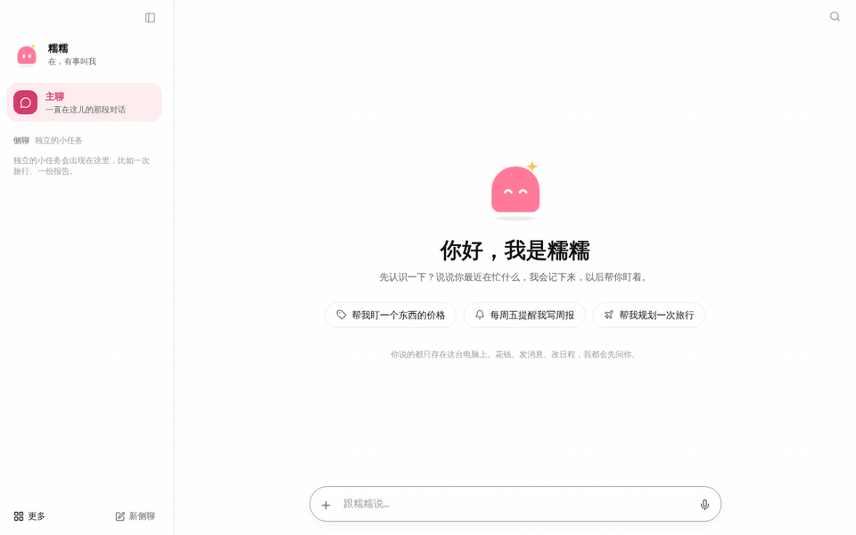
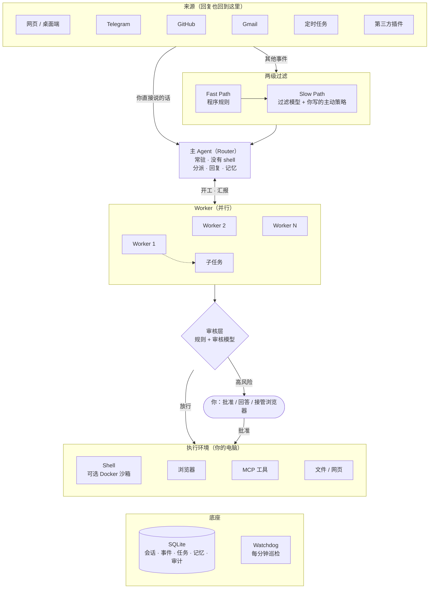
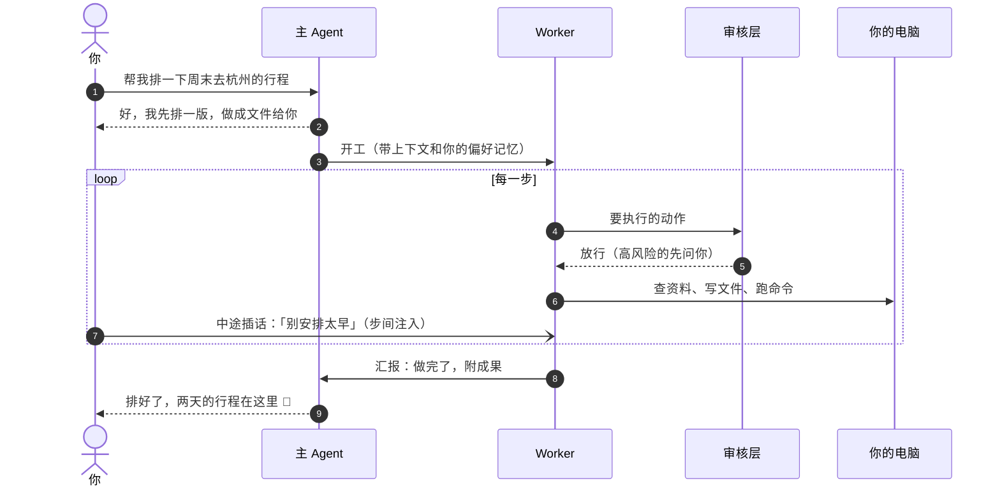

<div align="center">


# Super-assistant

**跑在你自己电脑上的个人助理。你说一句话，它在后台把事办完，再用一句话告诉你结果。**

[快速开始](#快速开始) · [设计理念](#设计理念) · [参考了什么](#参考了什么) · [架构](#架构) · [部署](#部署自己的电脑或服务器) · [文档](docs/)



</div>

## 它是什么

Super-assistant 是一个**常驻的个人助理**，不是写代码的 Agent。它的服务端和执行端都在你自己的机器上，你在网页、桌面端、Telegram、GitHub 或邮件里跟它说话，它把事情拆给后台的执行者去做：查资料、排行程、整理文件、盯一个 PR、每天早上给你一份摘要。做完了，它只回你一句话，完整的成果放在「成果」里。

上面的动图是真实运行的录屏（只把等待的部分加速了）：说一句「帮我排一下周末去杭州的行程」，主 Agent 先回一句，Worker 在后台查天气、查开放时间、写成一份网页，右侧「今天」面板一直显示它在做什么；做完后它只回一段话，想看它具体做了哪些步骤可以点开任务详情，交付的网页在「成果」里直接打开。

## 设计理念

### 1. 助理，而不是工具

编码 Agent 的界面是一条长长的执行轨迹，你得盯着它。个人助理应该像一个靠谱的人：你交代一句，它说「好」，然后去做；你不用看它怎么做的。所以：

- **对话里只有你和它说的话。** 工具调用、命令、思考过程都不出现在对话里；做事时只有一行「正在处理：…」，做完只回一句结果。
- **它有名字、头像和性格。** 头像会随状态变化（空闲、在听、在做、在想、等你），一眼就知道它在干什么。
- **只有需要你时才打断你。** 要你批准、要你回答、要你接管浏览器登录时，才出现一张大白话卡片。

### 2. 人的注意力才是瓶颈

一个人同时只跟得住 3–5 个会话，瓶颈在人，不在模型。所以「会话」只是实现细节：你面对的始终是**一个**助理，它背后同时跑着很多个 Worker，每件事一个，互相隔离、并行推进。你不需要知道 Session、Ticket、Worker 这些词。

### 3. 连续、高效、主动、持久

这四个词来自 DeepSeek 的《Super-agent 设计探索》，也是这个项目的验收标准：

| | 含义 | 在这里怎么做到 |
|---|---|---|
| **连续** | 不管在哪里找它，感觉都是同一个它 | 网页、Telegram、GitHub、Gmail 都是同一条管线上的「来源」；外部讨论镜像成对话，一件事可以跨渠道接着做 |
| **高效** | 多件事并行，不互相卡住 | 主 Agent 只负责分派，Worker 并行执行；耗时命令自动转后台 |
| **主动** | 没人叫它也能发现该做的事 | 外部事件先过程序规则，再由过滤模型按你写的自然语言策略判断；可以在本地悄悄先做，有价值才告诉你 |
| **持久** | 一直在线，出了问题能自己恢复 | 本机常驻服务 + 开机自启；状态全部落在 SQLite，重启后接着做；Watchdog 盯着卡住和空转的任务 |

### 4. 安静是默认值

打扰是有成本的。即时通讯类渠道的回复有硬性的长度上限（约 100 字，超了回复工具直接拒绝发送）；主动处理默认不对外发任何东西；后台做完一件事，结果没价值就不出声。「什么都不说」是一个合法的结果。

### 5. 本地优先，你说了算

- **服务和执行都在你的机器上**，只监听 `127.0.0.1`；模型自带密钥（BYOK），每一层用什么模型你自己选。
- **凭据永远不进模型上下文**：密钥在系统钥匙串或加密文件里，也会从 Worker 的环境变量里剔除；读取凭据的命令会被直接拦下。
- **有后果的动作要过审核层**：规则加审核模型，高风险的一律问你，所有决定都记入审计。
- **记忆是你的**：带来源、置信度和有效期，可以查看、修改、删除；外部来源（邮件、别人的评论）只能进「等你确认」。

### 6. 用结构约束，而不是靠提示词

「请优先把活派出去」这种提示词，五次里会有一次被模型忽略。所以重要的约束都写在代码里：主 Agent **没有 shell**，只能派活；谁的话能直接写进记忆，由代码判断来源和信任级别，不由模型判断；静默工作在结构上就没有对外发送的工具。

## 参考了什么

| 来源 | 借鉴了什么 |
|---|---|
| DeepSeek《Super-agent 设计探索：迈向更自主的 Agent 系统》 | 整体架构：Router / Worker 双层、事件驱动（两级过滤、订阅直通、Inline & Spill、投机执行）、全双工多信道交互、计算与状态分离、外部 Watchdog。逐节对照见 [07-architecture](docs/07-architecture.md) |
| [deepseek-ai/dsh-superagent-prototype](https://github.com/deepseek-ai/dsh-superagent-prototype)（MIT） | 领域模型：Source / Trigger / Thread / Ticket / Subscription / Report，Policy 门控、Ticket 阶段表、持久化副作用队列（Effects）。领域层按 MIT 协议移植并改写，运行时、模型层、插件层和前端是自研的。调研见 [00-research](docs/00-research.md) |
| Grok Bot | 常驻的具名助理、批准卡片、定时任务（routines）、自然语言规则 + 审核 Agent、「薄控制面、重执行面、记忆旁路」的记忆系统 |
| [Muse](https://muse.ai/blog/how-we-designed-muse) | 交互：一个主对话加侧聊、目标交给它后在后台推进、有结果才回来、助理的个性；成果在对话里直接预览。见 [09-m6](docs/09-m6-muse-and-memory.md) |
| 论文发布后的业界解读 | 「上下文不等于授权」「委派必须是结构性的」「沉默是合法的结果」等观点，逐条查漏补缺，见 [08-industry-review](docs/08-industry-review.md) |
| 界面 | OMRIC 风格的灰阶 + 钴蓝、倾斜的彩色标签、[Lucide](https://lucide.dev) 图标、[Geist](https://vercel.com/font) 字体；吉祥物是原创的蓝色小云 |

技术栈：Node.js 22 + [Hono](https://hono.dev)、SQLite + [Drizzle](https://orm.drizzle.team)、React 19 + Vite + Tailwind 4、[Vercel AI SDK](https://ai-sdk.dev)、[MCP](https://modelcontextprotocol.io)、Playwright（浏览器工具）、Electron（桌面端）。

## 架构

所有东西都在一个本机进程里：一个 Node 服务、一个 SQLite 文件、一个可以直接用文本编辑器查看的数据目录。



一句话从说出口到交付，经过这些步骤：



几个关键设计：

- **主 Agent 和 Worker 分开**：主 Agent 用中等、快、缓存友好的模型，一直在线保证连续性；Worker 用最强的模型做事，不直接跟人说话，只向主 Agent 汇报。各层（过滤、审核、Watchdog、摘要、向量、视觉…）可以分别配不同的模型，没配的沿用上一层。
- **事件驱动**：网页消息、GitHub 评论、邮件、定时任务都是同一种 Trigger；回复回到消息来的地方。你直接对它说的话进主 Agent；没人找它的外部事件先过两级过滤。一件事开工后，同一线程的后续事件由程序直接送给订阅它的 Worker（订阅直通），不用再经过主 Agent。
- **无状态的 Agent 循环**：每一步都从 SQLite 重建上下文，进程随时可以重启；长输出写进 blob，窗口里只留引用，需要时用 `recall` 链式召回。
- **全双工**：Worker 执行时你可以随时插话，新消息在推理步之间注入；耗时命令自动转后台，跑完再继续。
- **外部 Watchdog**：一个独立的会话每分钟巡检一次，发现卡住、死循环、空转的任务就提醒、重启或告诉你；你也可以在它的对话里直接问「刚才那个任务怎么了」。

代码布局：

```
apps/daemon     本机服务：Hono API、SSE、CLI、组合根
apps/web        前端：React 19 + Vite + Tailwind 4（构建后由 daemon 托管）
apps/desktop    Electron 桌面端
packages/core   领域层：Trigger / Thread / Ticket / 订阅 / 汇报，主 Agent 与 Worker 的工具和提示词，审核、记忆、Watchdog
packages/agent-runtime  Agent 运行时：事件日志、步间注入、后台命令、文件 / Shell / 网页工具、recall、压缩
packages/sources        来源插件协议、插件加载器、GitHub 来源、定时任务
packages/plugins        内置插件：Telegram、Gmail
packages/plugin-sdk     写插件用的类型与工具
packages/models         供应商、BYOK 密钥存储、分层模型、用量账本
packages/db             SQLite + Drizzle、迁移、持久化副作用队列
```

## 快速开始

**Linux 服务器 / 无桌面（x64 / arm64）**，一行命令安装：

```sh
curl -fsSL https://raw.githubusercontent.com/cyDione/super-assistant/main/install.sh | bash
super-assistant start -d        # 后台运行；局域网访问加 --host 0.0.0.0 --port 7420
```

**macOS / Windows 桌面端**：从 [Releases](https://github.com/cyDione/super-assistant/releases) 下载对应系统和芯片的安装包。

启动后打开打印出来的登录链接，在「设置 → 模型供应商」里填上你自己的 API key，就可以开始说话了。后台运行、监听地址和端口、从源码运行、开机自启、远程访问等见下面的[部署](#部署自己的电脑或服务器)。

## 功能一览

- **对话**：一个主对话加侧聊；执行中途可以插话；批准可以选「这件事里都同意」；成果在对话里直接预览，HTML 可以交互。
- **「今天」与「动态」**：需要你的事、正在做的、接下来的定时任务、主动留意到的事，一目了然；交给你的文件放在「成果」。
- **定时任务**：直接说「每天 9 点…」即可创建。
- **主动处理**：关闭 / 观察 / 自动三种模式，策略用自然语言写。
- **来源与插件**：GitHub（在 Issue / PR 里 @它就能派活，跟进评审、CI 和合并）、Gmail（读邮件、写草稿，发送由你决定）、Telegram（用手机指挥家里的电脑）、MCP 工具、第三方插件 SDK。
- **记忆**：关于你 / 项目 / 近期 / 经验四类，带来源、置信度和有效期，后台自动整理。
- **说明**：沟通方式 / 做事边界 / 交付要求，对它说「以后……」会自动记下，带版本。
- **安全**：审核层、审计日志、凭据隔离、可选 Docker 沙箱、浏览器登录由你接管。
- **运维**：Watchdog、重启自动恢复、分层模型与用量预算、在线自动更新。

各阶段的设计与实现记录：[01-m1](docs/01-m1-implementation.md) · [02-m2](docs/02-m2-implementation.md) · [03-m3](docs/03-m3-implementation.md) · [04-plugin-sdk](docs/04-plugin-sdk.md) · [05-m4](docs/05-m4-implementation.md) · [06-audit](docs/06-audit.md) · [07-architecture](docs/07-architecture.md) · [08-industry-review](docs/08-industry-review.md) · [09-m6](docs/09-m6-muse-and-memory.md) · [10-oauth](docs/10-oauth.md)

## 部署（自己的电脑或服务器）

服务和执行都在你自己的机器上。默认只监听 `127.0.0.1`，不对外开放端口；需要时可以改成监听局域网地址。

### 安装包（推荐）

每个 [Release](https://github.com/cyDione/super-assistant/releases) 都有下面这些包，都自带 Node.js，不用另装运行环境：

| 平台 | CPU | 文件 | 形态 |
|---|---|---|---|
| Linux（服务器 / 无桌面） | x64（amd64）、arm64 | `super-assistant-<版本>-linux-<x64\|arm64>.tar.gz` | 后台服务 + 网页界面 |
| macOS | Apple 芯片（arm64）、Intel（x64） | `super-assistant-<版本>-mac-<arm64\|x64>.dmg`（或 `.zip`） | 桌面应用，网页访问可在设置里开启 |
| Windows | x64、arm64 | `super-assistant-<版本>-win-<x64\|arm64>-setup.exe`（或免安装 `.zip`） | 桌面应用，网页访问可在设置里开启 |

**Linux 一键安装**（x64 和 arm64 自动识别，不需要登录 GitHub）：

```sh
curl -fsSL https://raw.githubusercontent.com/cyDione/super-assistant/main/install.sh | bash
```

装到 `~/.local/share/super-assistant`，命令链接到 `~/.local/bin/super-assistant`；重复运行即升级，数据目录 `~/.super-assistant` 不受影响。指定版本：`SUPER_ASSISTANT_VERSION=v0.2.0`（放在 `bash` 前面）。

**Linux 后台运行、地址和端口**：

```bash
super-assistant start -d                                # 后台启动，打印登录链接（http://127.0.0.1:7420/auth?token=…）
super-assistant start -d --host 0.0.0.0 --port 8080     # 监听所有网卡的 8080 端口，局域网里的设备也能打开
super-assistant config --host 0.0.0.0 --port 8080       # 保存为默认值（写入 ~/.super-assistant/config.json），以后每次启动都用
super-assistant status | stop | restart                 # 查看 / 停止 / 用保存的设置重启
super-assistant service install                         # 开机自启（systemd 用户服务，同样读取保存的地址和端口）
```

地址和端口的优先级：命令行参数 `--host/--port` > 环境变量 `SUPER_ASSISTANT_HOST/SUPER_ASSISTANT_PORT`（也可以写进 `~/.super-assistant/env`）> `config.json` > 默认 `127.0.0.1:7420`。网页的「设置 → 系统 → 监听地址」也能改，改完点「重启服务」生效。监听非本机地址时登录链接就是密码，而且是明文 HTTP：只在可信的局域网里这样用，远程访问请放在 HTTPS 反向代理后面，或用 `ssh -L 7420:127.0.0.1:7420 <服务器>`。

**macOS / Windows 桌面端**：下载对应的安装包安装即可。应用自带服务，关掉窗口后留在托盘里继续工作。默认只有应用窗口能用；想在浏览器（或手机等局域网设备）里打开，到「设置 → 系统 → 网页访问」勾选「允许在浏览器里打开」，选「仅本机」或「局域网」并设置端口，点「重启服务」，再复制登录链接。

- macOS 包没有 Apple 开发者签名（只做了 ad-hoc 签名）。第一次打开如果提示「已损坏」或「无法验证开发者」，运行 `xattr -dr com.apple.quarantine /Applications/Super-assistant.app`，或在 Finder 里右键 →「打开」。
- Windows 包没有代码签名，SmartScreen 提示时点「更多信息 → 仍要运行」。
- 桌面端有新版本时，「设置 → 系统 → 版本更新」会提示并给出下载链接，下载新安装包覆盖安装即可。

### 从源码部署

**1. 准备**：Node.js ≥ 22.12、pnpm、git。可选：`gh`（GitHub）、Docker（沙箱）、Chrome/Chromium（浏览器工具）。

```bash
git clone https://github.com/cyDione/super-assistant.git ~/super-assistant
cd ~/super-assistant
pnpm install
pnpm build
```

**2. 填 API key**（二选一）：
- 启动后在网页的「设置 → 模型供应商」里填写，key 存进系统钥匙串；
- 或写进数据目录的 `env` 文件。开机自启的服务读不到 shell 里的 `export`，用这个文件最稳：

```bash
mkdir -p ~/.super-assistant
printf 'OPENAI_API_KEY=sk-...\n' > ~/.super-assistant/env   # 每行 KEY=value；换成你用的供应商，也可放 *_BASE_URL、GITHUB_TOKEN 等
chmod 600 ~/.super-assistant/env
```

各层用哪个模型在「设置 → 分层模型」里选。想跳过这一步（比如测试），在 `env` 里加一行 `SUPER_ASSISTANT_MODEL=<模型 id>`，各层都用 `env` 里第一个供应商的这个模型；这只在首次启动、还没配置过任何层时生效。

**3. 启动，检查**：

```bash
node apps/daemon/dist/cli.mjs doctor          # 检查环境
node apps/daemon/dist/cli.mjs start           # 打印并打开登录链接（http://127.0.0.1:7420/auth?token=…）
```

可以加个别名：`alias super-assistant="node ~/super-assistant/apps/daemon/dist/cli.mjs"`。登录链接丢了，用 `super-assistant token` 重新打印。

**4. 开机自启**（macOS 用 launchd，Linux 用 systemd 用户服务）：

```bash
super-assistant service install        # 写入并启动；super-assistant service uninstall 移除
loginctl enable-linger $USER      # 仅 Linux：没登录桌面时也保持运行
```

**5. 可选**：
- **自己打包**：Linux 无桌面包 `pnpm build && bash scripts/package-linux.sh`（打的是本机 CPU 的包）；桌面端 `pnpm build`，再在 `apps/desktop` 里运行 `pnpm dist:mac` / `pnpm dist:win`（同样只能打本机系统和 CPU 的包）。GitHub Actions 的 “Release” 工作流在 6 台对应的机器上打全部的包；推送 `v*` 标签时自动发布 Release。发版前先用 `pnpm set-version 0.2.0` 把所有包改成同一个版本号并提交，再打 `v0.2.0` 标签；标签和版本号不一致时，工作流会报错并且不发布。
- **在外面用**：启用 Telegram 插件，用手机指挥家里的电脑，不需要开放端口。或者用 SSH 端口转发 `ssh -L 7420:127.0.0.1:7420 你的电脑`，再在本地打开登录链接；在同一个局域网里，也可以让服务监听局域网地址（见上面的「地址和端口」）。
- **GitHub**：在「设置 → 来源 → GitHub」点「授权 GitHub」，页面会给出一个验证码，在 github.com/login/device 输入并同意即可（设备码授权，不需要回调地址，通过 SSH 端口转发访问也能用）；再填写要监听的仓库。授权后智能体的 `gh` 和 git 也用这个授权。没有授权时仍会退回到 `env` 里的 `GITHUB_TOKEN` 或本机 `gh auth login`。
- **Gmail**：启用 Gmail 插件，在「设置 → 来源 → Gmail」点「授权 Gmail」，用 Google 账号登录并同意，浏览器会跳回本机服务（经 `ssh -L` 转发也可以）。随时可以点「断开授权」，会同时在 Google 那边撤销。
- 两个授权用到的 OAuth 应用怎么建，见 [docs/10-oauth.md](docs/10-oauth.md)。

**升级**：

用安装包（`install.sh`）装的：服务每天检查两次有没有新的 Release，有的话侧栏「设置」旁会显示「有更新」，在「设置 → 系统 → 版本更新」点「立即更新」即可，装完服务自动重启。命令行也可以：

```bash
super-assistant update --check   # 只检查
super-assistant update           # 下载并安装最新版本；systemd 服务会自动重启
```

仓库是公开的，检查和下载不需要登录 GitHub（`env` 里有 `GITHUB_TOKEN` 时会带上，只为提高 API 频率上限）。不想后台检查，在 `env` 里写 `SUPER_ASSISTANT_UPDATE_CHECK=0`。

v0.1.0 还没有自动更新功能：从 v0.1.0 升级，需要手动再运行一次上面的 `install.sh` 安装命令，之后的版本就可以用「立即更新」或 `super-assistant update` 了。

从源码运行的：

```bash
cd ~/super-assistant && git pull && pnpm install && pnpm build
```

升级后重启服务：`super-assistant service install`，或者停掉再 `start`。数据目录 `~/.super-assistant/` 不受影响，数据库会自动迁移。

**从旧名 superagent 升级**：项目改名后，命令、数据目录、环境变量和服务名都换了，旧名不再识别。已经部署过的话，按顺序做一次：

```bash
# 1. 先用旧版本停掉并移除旧服务（git pull 之前）
superagent service uninstall      # 或手动：launchctl unload -w ~/Library/LaunchAgents/dev.superagent.daemon.plist
                                  #        systemctl --user disable --now superagent.service
# 2. 拉新代码并构建
cd ~/super-assistant && git pull && pnpm install && pnpm build
# 3. 搬数据目录，改 env 文件里的变量名
mv ~/.superagent ~/.super-assistant
sed -i.bak 's/^\(export \)\{0,1\}SUPERAGENT_/\1SUPER_ASSISTANT_/' ~/.super-assistant/env
# 4. 用新命令装服务（别名也改成 super-assistant）
super-assistant service install
```

另外：存在系统钥匙串里的 API key 换了钥匙串条目名，需要在「设置 → 模型供应商」里重新填一次（放在 `env` 文件里的不受影响）；第三方插件 `package.json` 里的 `"superagent"` 字段改成 `"super-assistant"`；Gmail 派活标签的默认值变成 `super-assistant`，在用默认值的话把邮箱里的标签也改名。

**安全建议**：任务的命令以运行服务的用户身份执行。建议用一个单独的普通用户运行，或在「设置 → 执行环境」里把 Docker 沙箱设为「全部」。不要以 root 运行。

## 桌面端

macOS 和 Windows 直接用 Release 里的安装包（见上面「安装包」）。从源码运行：

```bash
pnpm build                      # 先构建服务和网页
cd apps/desktop && pnpm start   # 已有服务时直接连接；没有的话用系统 Node 启动它
```

- 关闭窗口时，应用会留在托盘里。
- 按 `Cmd/Ctrl+Shift+Space` 随时呼出窗口或打开新对话。
- 网页访问默认关闭，在「设置 → 系统 → 网页访问」开启（可选仅本机或局域网，以及端口）。
- 打包：`pnpm dist:mac` 或 `pnpm dist:win`，打出本机系统和 CPU 的安装包，里面带着服务和 Node.js。

## 命令行

| 命令 | 作用 |
|---|---|
| `super-assistant start [-d] [-H 地址] [-p 端口] [--no-open]` | 启动服务；`-d` 在后台运行（日志在 `~/.super-assistant/logs/daemon.log`），`-H 0.0.0.0` 让局域网可访问 |
| `super-assistant stop` / `restart` | 停止 / 重启服务（`restart` 在后台启动，用保存的地址和端口） |
| `super-assistant config [-H 地址] [-p 端口]` | 查看或保存监听地址和端口（下次启动生效） |
| `super-assistant status` | 查看是否在运行、监听地址，以及后台队列是否健康 |
| `super-assistant doctor` | 检查运行环境（Node、钥匙串、模型配置、git/gh/Docker） |
| `super-assistant token [--rotate]` | 打印登录链接；加 `--rotate` 时轮换访问令牌 |
| `super-assistant update [--check]` | 检查并安装新版本（Linux 安装包） |
| `super-assistant service install / uninstall` | 开机自启（macOS 用 launchd，Linux 用 systemd 用户服务） |

在仓库内开发时，可以用 `node apps/daemon/dist/cli.mjs <命令>` 代替 `super-assistant`。

## 开发

```bash
pnpm dev     # daemon（tsx watch，数据目录为 ./.super-assistant-dev）+ Vite（http://localhost:5173）
pnpm check   # 类型检查 + 测试 + 构建
```

开发模式下，daemon 会打印指向 `localhost:5173` 的登录链接；Vite 会把 `/api` 和 `/auth` 代理到 daemon。

## 数据与安全

- **数据目录**：默认是 `~/.super-assistant/`，可用 `SUPER_ASSISTANT_HOME` 修改。里面包括：`state.db`（SQLite）、`token`（访问令牌，权限 0600）、`work/`、`memory/`、`logs/`。
- **API key 存放位置**：只存在系统钥匙串里（macOS Keychain / Linux Secret Service），不进数据库、不进日志，也不会进入模型上下文。如果钥匙串不可用（例如无桌面的 Linux），会自动改用 `secrets/secrets.enc`（AES-256-GCM，密钥 `master.key` 的权限为 0600）。`SUPER_ASSISTANT_SECRETS=file|keychain` 可以强制指定其中一种。
- **网络访问控制**：服务只监听 `127.0.0.1`。所有 API 都需要访问令牌（HttpOnly + SameSite=Strict 的 cookie，或 Bearer 头），并校验 `Host` 与 `Origin`，防止 DNS rebinding 和其他网页伪造请求。

## 路线图

- ~~M1~~：主 Agent + Worker 双层架构、异步 job、任务卡片、「待你处理」（已完成）
- ~~M2~~：GitHub 插件、定时任务（Routine）、Agent 主动发起对话（已完成）
- ~~M3~~：Reviewer 审核与规则、三层记忆、Watchdog、浏览器接管、Docker 沙箱（已完成）
- ~~M4~~：插件 SDK、MCP、Gmail / Telegram、Electron（已完成）
- ~~M5~~：按文章重新对齐——对话体验、主动处理、说明版本、子任务、链式召回（已完成）
- ~~M6~~：Muse 式主对话与个性、任务内授权、成果预览、记忆系统重做、设置归类（已完成）

## 许可

[MIT](LICENSE)。

领域设计参考了 [deepseek-ai/dsh-superagent-prototype](https://github.com/deepseek-ai/dsh-superagent-prototype)（MIT）。后续移植的代码会在对应文件中保留原版权声明。
