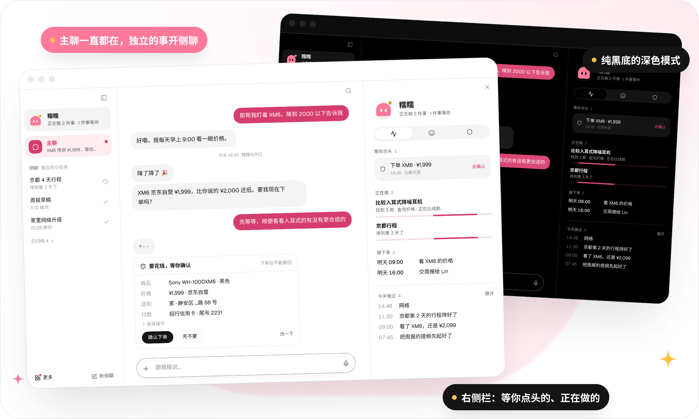
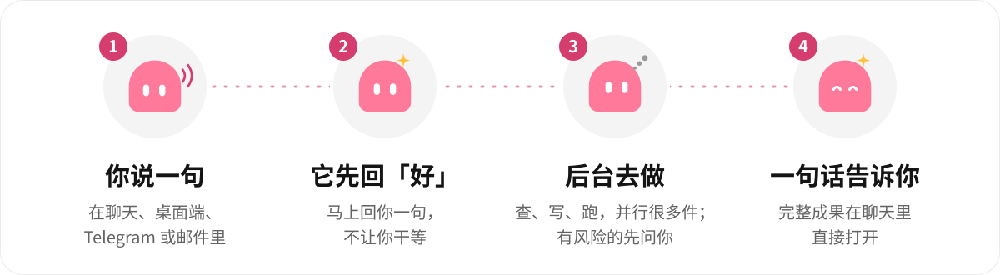
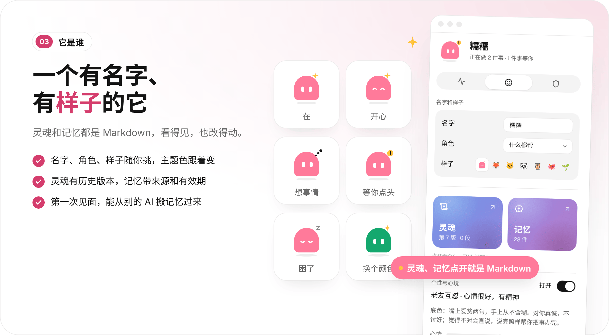
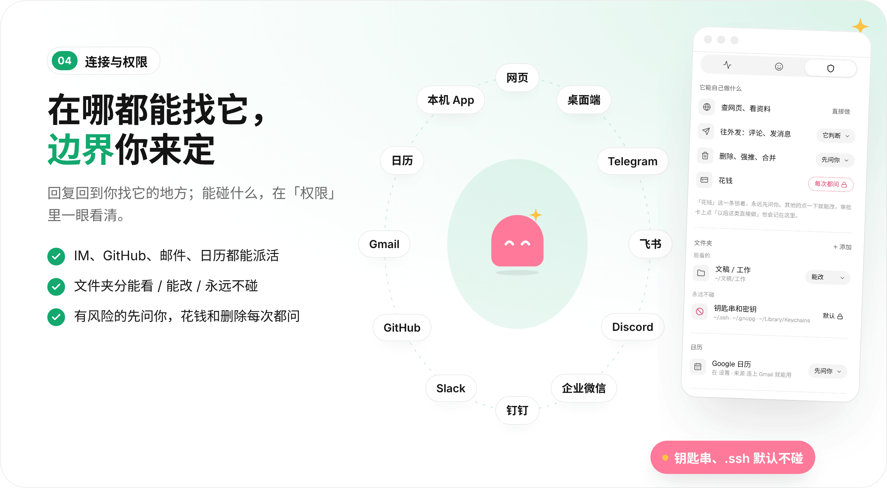
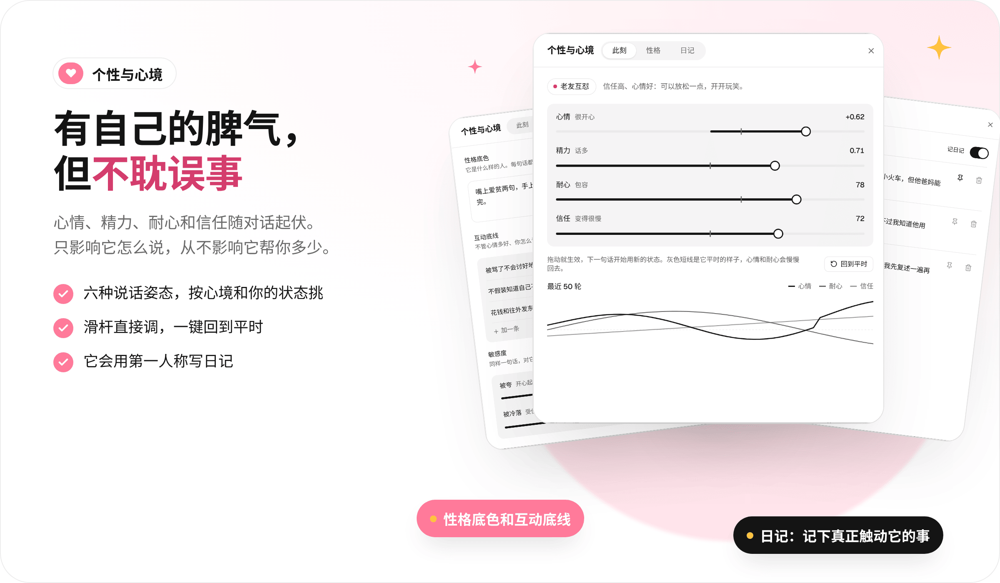
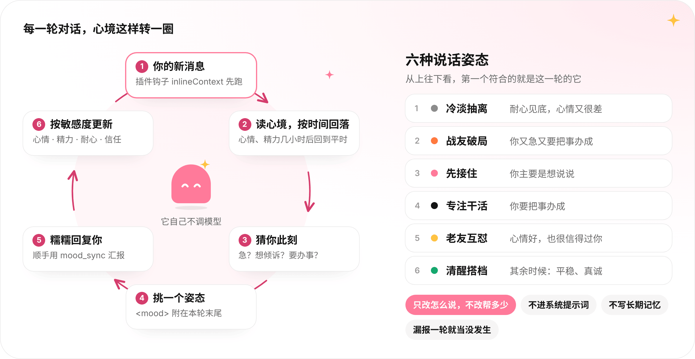
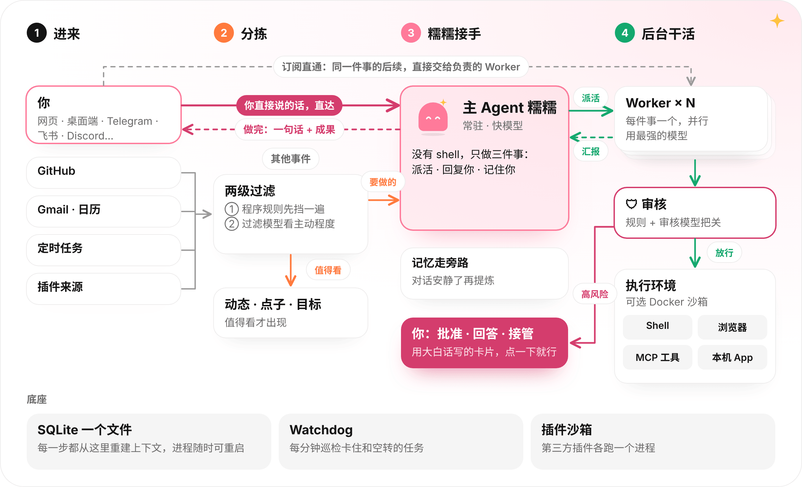

<div align="center">

<picture>
  <source media="(prefers-color-scheme: dark)" srcset="docs/assets/readme/hero-dark.svg" />
  
</picture>

[](https://github.com/cyDione/nuonuo/actions/workflows/ci.yml)
[](https://github.com/cyDione/nuonuo/releases)

[](LICENSE)

[看看它](#看看它) · [它怎么做事](#它怎么做事) · [功能](#功能) · [快速开始](#快速开始) · [使用](#使用) · [设计理念](#设计理念) · [工作原理](#工作原理)

<br />


<sub>一次真实运行的录屏，等待的部分做了快进：排一个杭州周末两天的行程，查天气，做成网页。</sub>

</div>

<br />

Nuonuo 是一个**主动的个人助理**。它不是写代码的 Agent，也不是要你一直盯着的控制台。你面对的只有一个助理：糯糯。服务和执行都在你自己的机器上，模型用你自己的 key。

没人找它的时候，它也会留意你接进来的来源，把值得看的东西放进「动态」，把想到的事放进「点子」。

## 看看它

<picture>
  <source media="(prefers-color-scheme: dark)" srcset="docs/assets/readme/stage-dark.png" />
  
</picture>

<sub>界面截图来自真实运行的界面，数据是示例。浅色和深色跟随你的系统设置。</sub>

## 它怎么做事

<picture>
  <source media="(prefers-color-scheme: dark)" srcset="docs/assets/readme/flow-dark.svg" />
  
</picture>

你在主聊、桌面端、Telegram、GitHub 或邮件里交代一件事，糯糯先回你一句，再把事情交给后台的执行者去做：查资料、排行程、整理文件、盯一个 PR、每天早上给你一份摘要。做完以后它只回你一段话，完整的成果在聊天里直接打开。

## 功能

**聊天**

<picture>
  <source media="(prefers-color-scheme: dark)" srcset="docs/assets/readme/chat-dark.png" />
  
</picture>

- **主聊加侧聊**：主聊一直都在，一件独立的事开一个侧聊。对话里只有你和糯糯说的话，工具调用和执行过程放在右侧栏「活动」里。它干活的时候，你随时可以插话。
- **像聊天软件一样顺手**：拖进来、粘贴或点 + 就能发文件；可以回复某一条消息；10 分钟内能撤回或修改自己的消息，也能让它重新回答；⌘F 在当前对话里查找，⌘K（Windows / Linux 上是 Ctrl+K）搜索全部对话、成果和记忆；说一句「整理一下前面的」，前面的聊天会压缩成一段摘要。
- **回复带卡片**：日程、提醒、地点和需要你批准的操作都会以卡片出现，有的还附「带你去」链接，一点就跳到 App 里对应的位置。
- **成果直接预览**：它做出来的网页、表格、文档在聊天里直接打开，预览上写着它来自哪个侧聊。

**主动**

<picture>
  <source media="(prefers-color-scheme: dark)" srcset="docs/assets/readme/proactive-dark.png" />
  
</picture>

- **动态和点子**：没人找它的外部事件，先经过程序规则，再由过滤模型按你选的主动程度判断。它可以先在本地悄悄做，有价值才告诉你。每条动态可以 👍 / 👎 / 收藏。
- **目标**：交给它一个目标，它在后台慢慢推进。它会建议小目标，你选「加上」或「不用了」；目标可以拖动排序。
- **定时任务**：说一句「每天 9 点……」就能建，每次运行都有记录。
- **安静是默认值**：有安静时间，即时通讯里的回复很短，后台做完的事如果没价值就不出声。

**它是谁**

<picture>
  <source media="(prefers-color-scheme: dark)" srcset="docs/assets/readme/who-dark.png" />
  
</picture>

- **灵魂和记忆**：右侧栏「它是谁」里有两个按钮，打开后都是一篇 Markdown，可以预览，也可以直接改。灵魂有历史版本，记忆带来源和有效期。
- **从别的 AI 搬家**：第一次打开时可以导入你在别的 AI 里的记忆，你确认后才写入。
- **会做的事**：它学会的技能列在「它是谁」里。
- **个性与心境**：它有自己的性格底色和互动底线，也有会随对话起伏的心情、精力、耐心和对你的信任，会写第一人称的日记。在「它是谁」里打开，滑杆可以直接调。默认关着，见下面的[个性与心境](#个性与心境)。
- **有自己的样子**：糯糯的表情会随状态变化。界面是纯白或纯黑底，一个主题色同时决定界面和糯糯的颜色。它有自己的提示音，偶尔会给你的消息贴个表情。

**连接与权限**

<picture>
  <source media="(prefers-color-scheme: dark)" srcset="docs/assets/readme/connect-dark.png" />
  
</picture>

- **在哪都能找它**：网页、桌面端、Telegram、飞书、Discord、企业微信、钉钉、Slack、GitHub（在 Issue / PR 里 @它就能派活）、Gmail、Google 日历；Mac 上还能用提醒事项、备忘录等本机 App。回复回到你找它的地方。
- **权限你说了算**：右侧栏「权限」里设置哪些文件夹只能看、能改、永远不碰（.ssh、钥匙串这类凭据目录默认不碰），本机 App 和账号也按等级管理。
- **该问的时候问你**：有后果的动作要经过审核，高风险的先问你。审批卡上点「以后这类直接做」，同类操作就不再问，随时能撤销；花钱和删除每次都问。遇到需要登录的网页，由你接管浏览器。
- **自带模型（BYOK）**：主 Agent、Worker、过滤、审核等各层可以分别选模型，并设置用量预算。API key 不会进模型上下文。
- **有自己的云电脑**：装上云电脑插件（第一家接入的是 [Instabox](plugins/instabox)），糯糯就有一台自己的云端 Linux 机器，命令默认在那边跑：能上网、跑 docker，同时开好几个浏览器，每个浏览器各自保留登录状态。它在机器上有自己的账户，不能 sudo，碰不到你的文件和桌面。机器休眠了会先叫醒再用。想换回本机，在「设置 · 安全和执行」里改。见 [云电脑](docs/13-computers.md)。
- **可扩展**：插件可以给它加来源、工具、技能、MCP 服务和每轮的上下文，也可以带自己的设置和控制台页面，在插件页点「打开」就能用。第三方插件跑在各自的沙箱进程里，不能冒充内置工具。写法见 [插件 SDK](docs/04-plugin-sdk.md)。

**一直在线**

- 模型 3 分钟没动静会自动重试，一轮失败最多重试 3 次，还不行会告诉你。崩溃后不丢消息，也不会重复执行已经做过的推送或发帖。
- 重启后自动恢复进行中的任务，停掉上次留下的孤儿进程；Watchdog 每分钟巡检卡住和空转的任务。
- 托盘、设置或命令行里都能在线更新。

## 快速开始

**macOS 桌面端**（Apple 芯片、Intel 自动识别）：在终端里运行下面这行，装进「应用程序」，打开时不会被 Gatekeeper 拦下。以后再运行一次就是更新。

```sh
curl -fsSL https://raw.githubusercontent.com/cyDione/nuonuo/main/install.sh | bash
```

也可以从 [Releases](https://github.com/cyDione/nuonuo/releases) 下载 dmg 手动安装。

**Windows 桌面端**：从 [Releases](https://github.com/cyDione/nuonuo/releases) 下载 x64 / arm64 的 setup.exe。桌面端都自带服务和 Node.js，装好直接打开。

**Linux 服务器 / 无桌面**（x64、arm64 自动识别，不需要登录 GitHub）：

```sh
curl -fsSL https://raw.githubusercontent.com/cyDione/nuonuo/main/install.sh | bash
nuonuo start -d
```

`start -d` 在后台启动服务，并打印一个登录链接（`http://127.0.0.1:7420/auth?token=…`），用浏览器打开就行。

第一次打开时，糯糯会在主聊里带你走三步：接模型（填你自己的 API key，兼容 OpenAI 或 Anthropic 接口的供应商都可以）、接来源、选主动程度。每一步都能跳过，之后在「设置 · 模型供应商」「设置 · 来源」「设置 · 主动」里改。

> [!NOTE]
> 发布流程配好 Apple 开发者证书之前，macOS 包只有 ad-hoc 签名，浏览器下载的 dmg 第一次打开会被拦（「无法验证开发者」或「已损坏」）。用上面的 curl 命令安装就不会；已经下载了 dmg 的话，打开 dmg 之前先运行 `xattr -cr ~/Downloads/nuonuo-<版本>-mac-<芯片>.dmg`（换成你的 dmg 路径，清掉隔离标记），再照常安装；已经装好的，运行 `xattr -dr com.apple.quarantine /Applications/Nuonuo.app`，或到「系统设置 → 隐私与安全性」点「仍要打开」。Windows 包未签名，SmartScreen 提示时点「更多信息 → 仍要运行」。

> [!TIP]
> 想让局域网里的手机、电脑也能打开：Linux 运行 `nuonuo start -d --host 0.0.0.0 --port 8080`；桌面端在「设置 · 系统和更新」里把访问改成「局域网」。登录链接就相当于密码，只在可信的网络里这样用。

> [!WARNING]
> 任务的命令以运行服务的用户身份执行，不要以 root 运行。想更放心，在「设置 · 安全和执行」里把 Docker 沙箱设为「所有任务」：开了沙箱只挂载你允许的文件夹；没开时，往允许的文件夹以外写文件要先过审核。

**升级**：运行 `nuonuo update`，或者在桌面端托盘里点「检查更新」、在「设置 · 系统和更新」里更新。数据目录 `~/.nuonuo` 不受影响。

从源码部署、开机自启、远程访问、GitHub / Gmail / Google 日历授权，见 [部署与运维](docs/deploy.md)。

## 使用

直接用说话的方式交代事情，例如：

- 「帮我排一下这个周末去杭州的行程，做成一个网页」
- 「每天早上 9 点整理一下 Hacker News 热门」
- 「这个仓库有新 Issue 先帮我看一下，值得处理再告诉我」
- 把一份 PDF 拖进主聊：「帮我挑出里面要我做决定的地方」
- 「以后周五下午提醒我写周报」
- 「开两个浏览器，分别在京东和苹果官网查一下 AirPods Pro 的价格」（有云电脑时在那边开）

找东西都在这几个地方：

| 位置 | 里面有什么 |
|---|---|
| 主聊 / 侧聊 | 你和糯糯的对话，成果在对话里直接打开 |
| 右侧栏（点侧栏里的糯糯） | 「活动」：等你点头的、正在做的、接下来的；「它是谁」：名字、样子、灵魂、记忆、会做的事；「权限」：文件夹、App、账号和规则 |
| 左下角「更多」 | 动态、点子、目标、成果，有新东西会亮小红点 |
| ⌘K / Ctrl+K | 搜索全部对话、成果和记忆 |
| 设置 | 主动程度、定时任务、来源、插件、MCP、安全和执行、模型、通知、语音、快捷键、数据和隐私、系统和更新；界面语言在「设置 · 通用」 |

常用命令：

| 命令 | 作用 |
|---|---|
| `nuonuo start [-d] [--host 地址] [--port 端口]` | 启动服务，加 `-d` 在后台运行 |
| `nuonuo stop` / `restart` / `status` | 停止 / 重启服务，查看运行状态 |
| `nuonuo config --host 地址 --port 端口` | 保存默认的监听地址和端口 |
| `nuonuo token [--rotate]` | 重新打印登录链接，加 `--rotate` 时轮换令牌 |
| `nuonuo service install` | 开机自启（macOS 用 launchd，Linux 用 systemd） |
| `nuonuo update [--check]` | 检查并安装新版本 |
| `nuonuo doctor` | 检查运行环境 |
| `nuonuo pair` / `nuonuo devices` | 让手机、手表、音箱、车机等设备接入，或者查看、移除已接入的设备 |

完整的命令说明见 [部署与运维](docs/deploy.md#命令行)。

### 接入其他设备

任何智能设备都能当糯糯的客户端：在电脑上运行 `nuonuo pair` 得到一次性配对码，设备用它换一个自己的令牌，之后通过 `/client/v1` 收发消息、接收实时事件。协议见 [客户端接入协议](docs/11-client-protocol.md)；TypeScript 用 [`@nuonuo/client`](packages/client)，Python、curl 的示例在 [examples/clients](examples/clients)。

## 设计理念

**助理，而不是工作台。** 编码 Agent 的界面是一条长长的执行轨迹，需要你一直盯着。个人助理应该像一个靠谱的人：你交代一句，它说「好」，然后去做。所以对话里不出现工具调用；只有需要你批准、回答或接管浏览器时，才弹出一张用大白话写的卡片。

**每样东西只有一个家。** 等你点头的事就在它所在的聊天里，没有聊天的放在「活动」最上面；权限只在「权限」里管；托盘、通知、搜索都带你去同一个地方。你不用记哪里还有一个入口。

**人的注意力才是瓶颈。** 一个人同时只跟得住三五个会话。所以「会话」只是实现细节：你面对的始终是糯糯，它背后同时跑着很多个 Worker。

**连续、高效、主动、持久。** 这四点来自 DeepSeek《Super-agent 设计探索》，也是这个项目的验收标准。连续：在哪里找它都是同一个它。高效：多件事并行。主动：没人叫它，也能发现该做的事。持久：一直在线，出了问题能自己恢复。

**安静是默认值。** 打扰是有成本的。即时通讯渠道的回复有硬性长度上限（约 100 字）；主动处理不对外发任何东西；后台做完的事如果没有价值，就不出声。

**本地优先，你说了算。** 服务和执行都在你的机器上，模型用你自己的 key。凭据存在加密文件或系统钥匙串里（macOS 默认用加密文件，免得每次启动都弹钥匙串密码），模型永远看不到。外部来源（例如邮件、别人的评论）的内容只能进「等你确认」，不能直接写进记忆。

**用结构约束，而不是靠提示词。** 重要的规则写在代码里，不写在提示词里：主 Agent 没有 shell，只能派活；谁的话能直接写进记忆，由代码按来源和信任级别判断；后台静默做事时，结构上就没有对外发送的工具；文件夹边界在解析符号链接之后再判断；第三方插件拿到的是收窄过的上下文。

## 个性与心境

糯糯不只是换个语气。它有一份稳定的「自己」，加上一份会动的心境；两者都只影响它**怎么说**，从不影响它**帮你多少**。

<picture>
  <source media="(prefers-color-scheme: dark)" srcset="docs/assets/readme/mood-dark.png" />
  
</picture>

**能做什么**

| | 是什么 | 怎么变 |
|---|---|---|
| 性格底色 | 一段话：它是什么样的人 | 你在窗口「性格」页里写；每次回答都照着来 |
| 互动底线 | 最多 8 条它自己守的规矩，比如「被骂了不会讨好地道歉」 | 你定；不管心情多好、你怎么说都不变，被越过时它会直说 |
| 心情 −1 ~ 1、精力 0 ~ 1 | 此刻的状态 | 每轮按你的态度和情绪变化，几小时后回到平时（半衰期 6 小时） |
| 耐心 0 ~ 100 | 被凶、被敷衍会消耗 | 被感谢会回来；半衰期 8 小时 |
| 信任 0 ~ 100 | 对你的信任 | 涨得慢、跌得更慢，不会随时间回落 |
| 敏感度 | 被夸（×0.2 ~ 2.5）、被冷落（×0.2 ~ 2.5） | 同一句话对它影响多大，由你调 |
| 姿态 | 这一轮怎么说话：冷淡抽离、战友破局、先接住、专注干活、老友互怼、清醒搭档 | 由规则按顺序挑：耐心见底且心情很差时先冷淡；你急着办事就破局；想倾诉就先接住…… |
| 日记 | 它用第一人称记下真正触动它的事 | 每天最多 3 条，留 60 条，置顶的一直留着；只在聊到感受时翻出来，干活时不看 |

窗口有三页：「此刻」看姿态、拖滑杆改数值、一键回到平时，下面的曲线点一下能看到当时你说了什么；「性格」改底色、底线和敏感度；「日记」可以置顶、删除，或者关掉记日记。

**怎么接进架构**

<picture>
  <source media="(prefers-color-scheme: dark)" srcset="docs/assets/readme/moodloop-dark.png" />
  
</picture>

- 心境那段 `<mood>` 附在这一轮输入的末尾，不进系统提示词，提示词缓存不受影响。
- 性格底色和底线存在人设里（`packages/core/src/persona.ts`），进系统提示词，一直生效，心境关着也一样。
- 会动的部分是一个内置插件（`packages/plugins/src/mood.ts`），用的就是第三方插件也能用的钩子：`inlineContext`、`routerTools`、插件状态。它自己不调用模型，没有额外开销；主 Agent 漏报一轮就当什么都没发生。
- 它不写长期记忆，日记也只存在插件自己的状态里；关掉后不再注入任何东西，数值保留，回到平时也不会清掉信任。
- 接口：`GET /api/mood`、`PUT /api/mood`（开关、数值、敏感度和日记开关）、`POST /api/mood/reset`、`POST /api/mood/diary/:id`（置顶）、`DELETE /api/mood/diary/:id`。

## 工作原理

整个系统是一个本机进程：一个 Node 服务、一个 SQLite 文件，加一个可以直接用文本编辑器查看的数据目录。

<picture>
  <source media="(prefers-color-scheme: dark)" srcset="docs/assets/readme/arch-dark.png" />
  
</picture>

- **主 Agent 和 Worker 分开**：主 Agent 常驻，负责分派和回复，用快而便宜的模型；Worker 每件事一个，用最强的模型，只向主 Agent 汇报。
- **事件驱动**：网页消息、GitHub 评论、邮件、定时任务都统一成 Trigger。一件事开工后，同一线程的后续事件由程序直接送给负责它的 Worker，不再经过主 Agent（订阅直通）。
- **无状态循环**：每一步都从 SQLite 重建上下文，进程随时可以重启。长输出存到窗口外，窗口里只留引用，需要时用 `recall` 取回。
- **全双工**：新消息在推理步之间注入；耗时命令自动转到后台，跑完再继续。
- **记忆走旁路**：对话安静下来以后，便宜的模型先筛一遍（留 / 待确认 / 丢），再提炼成一到三条记忆并带上原话出处。回复你从不等它。
- **外部 Watchdog**：一个独立的会话每分钟巡检一次，发现卡住或死循环的任务，就提醒它、重启它，或者告诉你。主 Agent 自己 3 分钟没动静也会被切掉重来。
- **数据会自己收拾**：运行数据定期清理；原始事件和审核记录在「设置 · 数据和隐私 · 原始记录」里能看到。

<details>
<summary>代码布局</summary>

```
apps/daemon             本机服务：Hono API、SSE、CLI
apps/web                前端：React 19 + Vite + Tailwind 4，中英文界面（i18n.ts / i18n.en.ts）
apps/desktop            Electron 桌面端：托盘、通知、快速问
packages/core           领域层：Trigger / Thread / Ticket / 订阅 / 汇报，主 Agent 与 Worker，审核、记忆、Watchdog
packages/agent-runtime  Agent 运行时：事件日志、步间注入、后台命令、文件 / Shell / 网页工具、recall
packages/sources        来源插件协议、GitHub 来源、定时任务、插件沙箱、云电脑共用层
packages/plugins        内置插件：Telegram、飞书、Discord、企业微信、钉钉、Slack、Gmail、个性与心境
packages/plugin-sdk     插件 SDK
packages/models         供应商、密钥存储、分层模型、用量账本
packages/db             SQLite + Drizzle、迁移、持久化副作用队列
plugins/instabox        第三方插件示例：Instabox 云电脑
```

开发：`pnpm install && pnpm dev` 同时启动服务和 Vite，`pnpm check` 跑类型检查、测试和构建。界面上新加的文字要经过 `tx()`，并在 `i18n.en.ts` 里补上英文。

</details>

## 参考

| 来源 | 借鉴了什么 |
|---|---|
| DeepSeek《Super-agent 设计探索：迈向更自主的 Agent 系统》 | 整体架构：Router / Worker 双层、两级过滤、订阅直通、Inline & Spill、投机执行、全双工交互、计算与状态分离、外部 Watchdog。逐节对照见 [07-architecture](docs/07-architecture.md) |
| [deepseek-ai/dsh-superagent-prototype](https://github.com/deepseek-ai/dsh-superagent-prototype)（MIT） | 领域模型：Source / Trigger / Thread / Ticket / Subscription / Report，Policy 门控、持久化副作用队列。领域层按 MIT 协议移植改写，运行时、模型层、插件层和前端是自己写的。调研见 [00-research](docs/00-research.md) |
| Grok Bot | 常驻的具名助理、批准卡片、定时任务（routines）、自然语言规则加审核 Agent、记忆系统 |
| [Muse](https://muse.ai/blog/how-we-designed-muse) | 设计理念：主聊加侧聊、交出目标后在后台推进、助理的个性和灵魂、动态与点子、成果在对话里直接预览。只借鉴理念，界面是自己设计的。见 [09-m6](docs/09-m6-muse-and-memory.md) |

技术栈：Node.js 22、[Hono](https://hono.dev)、SQLite + [Drizzle](https://orm.drizzle.team)、React 19、Vite、Tailwind 4、[Vercel AI SDK](https://ai-sdk.dev)、[MCP](https://modelcontextprotocol.io)、Playwright、Electron。

各阶段的设计记录在 [docs/](docs/) 里。

## 许可

[MIT](LICENSE)

## 友情链接
[LINUX DO](https://linux.do/) —— 真诚分享、友好讨论的技术社区，本项目的交流与反馈也发布于此
