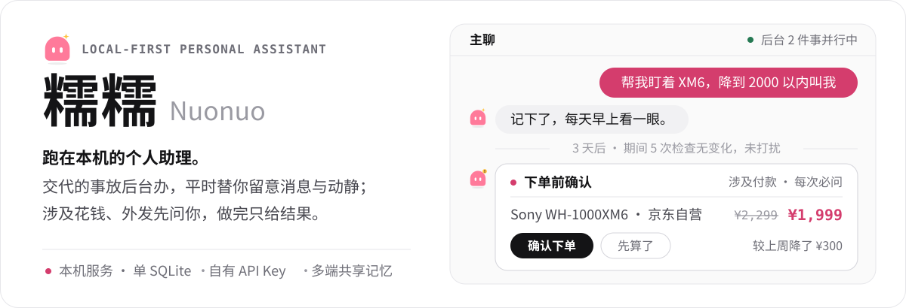
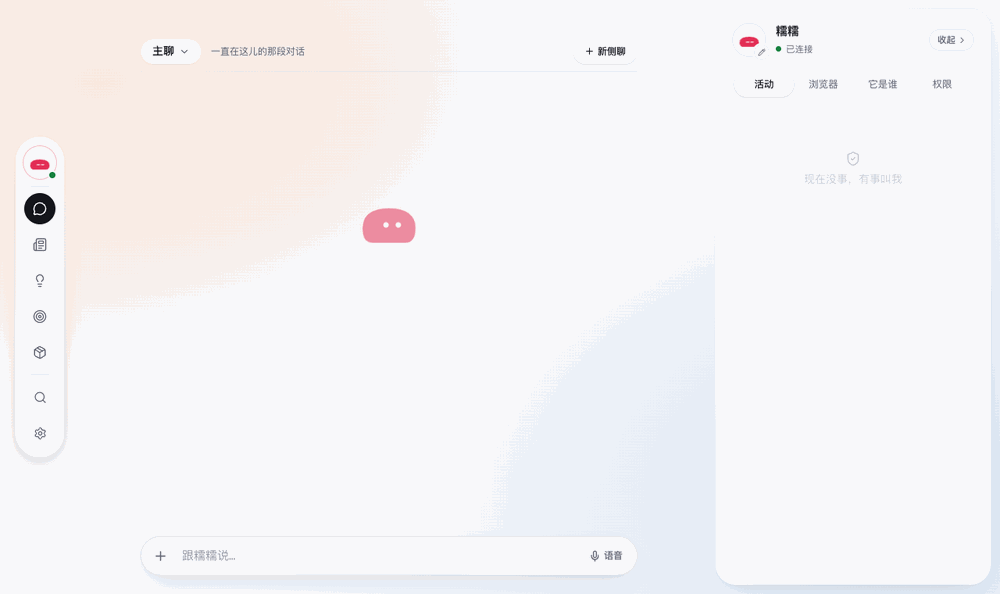
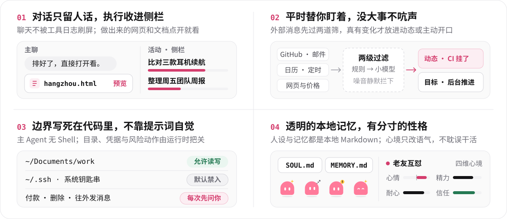
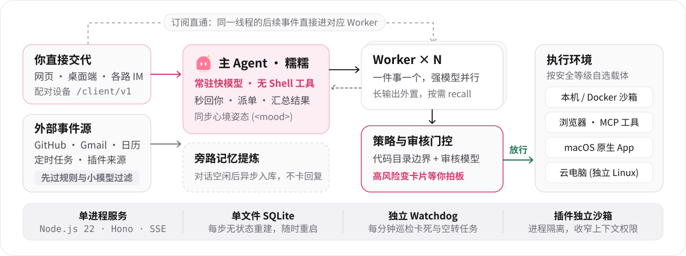

[](https://github.com/cyDione/nuonuo/actions/workflows/ci.yml)
[](https://github.com/cyDione/nuonuo/releases)

[](LICENSE)

[核心设计](#核心设计) · [快速安装](#快速安装) · [日常怎么用](#日常怎么用) · [系统架构](#系统架构) · [致谢与参考](#致谢与参考)



*实机录屏（等待部分已快进）：一句话交代排杭州周末两日行程，后台查完天气并做好网页，直接在聊天里打开。*

糯糯是一个跑在你自己机器上的个人助理。发消息交代一件事，它应一声就放到后台去办——查资料、盯商品降价、跟进仓库 Issue、整理本地文件、排好行程做成网页；做好以后把成品发回聊天里，点开就能看。

服务、数据和执行都在本地，模型填你自己的 API Key（兼容 OpenAI 或 Anthropic 接口的供应商均可）。平时没人找它，它也会按你设定的主动程度留意邮件、日历和订阅来源，筛掉噪音，只在真有变化时开口。

## 核心设计



- **聊天干净，多件事并行**：主聊常驻，独立任务开侧聊，互不串线。工具调用和执行进度收在右侧「活动」栏，干活中途随时可以插话补充。支持拖入文件、引用回复、撤回重答与 `⌘K` / `Ctrl+K` 全局搜索，生成的网页、表格、文档直接在对话内预览。
- **在哪找它都是同一个**：支持网页、macOS / Windows 桌面端、Telegram、飞书、Discord、企业微信、钉钉、Slack、GitHub（在 Issue / PR 里直接 `@` 派活）、Gmail、Google 日历，以及 macOS 原生的提醒事项与备忘录。消息从哪里发来，结果就回哪里。
- **权限与执行环境可控**：文件夹按「只读 / 允许读写 / 禁入」分级（符号链接解析后校验，`~/.ssh` 与系统钥匙串默认禁入）；高风险动作弹卡片确认，支持开启「同类操作以后直接做」，但付款与删除每次必问。除本机与 Docker 沙箱外，也可接入 [云电脑](docs/13-computers.md)（如 [Instabox](plugins/instabox)）让它在云端独立 Linux 与常驻浏览器里跑任务，不碰本机环境。
- **透明的记忆与有分寸的性格**：人设（`SOUL.md`）与长期记忆（`MEMORY.md`）都是本地可读可改的 Markdown，带历史版本与原话出处，首次启动可导入你在其他 AI 里攒下的记忆。内置双层心境模型（心情、精力、耐心、信任与互动底线），情绪起伏只改变说话姿态，气头上的狠话只会进「待确认」，不会直接污染长期记忆。

## 快速安装

**macOS 桌面端**（自动识别 Apple Silicon / Intel，直接装入「应用程序」，重复运行即升级）：

```sh
curl -fsSL https://raw.githubusercontent.com/cyDione/nuonuo/main/install.sh | bash
```

**Windows 桌面端**：从 [Releases](https://github.com/cyDione/nuonuo/releases) 下载 `x64` / `arm64` 的 `setup.exe`（内置服务与 Node.js，安装即用；macOS 也可在此手动下载 `.dmg`）。

**Linux / 无桌面服务器**（自动识别 `x64` / `arm64`）：

```sh
curl -fsSL https://raw.githubusercontent.com/cyDione/nuonuo/main/install.sh | bash
nuonuo start -d
```

后台启动后会打印带登录令牌的访问链接（`http://127.0.0.1:7420/auth?token=…`），用浏览器打开即可。首次进入时，糯糯会在对话里带你填 API Key、连接常用来源并选择主动程度，每一步都可随时在设置中修改。

> [!IMPORTANT]
> 请勿以 `root` 身份运行服务。需要更强隔离时，可在「设置 · 安全和执行」将 Docker 沙箱设为「所有任务」（仅挂载授权目录）。

- **手动安装包签名提示**：配好正式开发者证书前，若手动下载 macOS `.dmg` 提示无法验证，安装前运行 `xattr -cr ~/Downloads/nuonuo-<版本>-mac-<芯片>.dmg` 清除隔离标记即可（用上方 `curl` 安装不受影响）；Windows 遇 SmartScreen 点「更多信息 → 仍要运行」。
- **局域网访问与升级**：Linux 加 `--host 0.0.0.0 --port 8080` 或桌面端设置改为「局域网」可在可信网络内供手机访问；升级运行 `nuonuo update`，开机自启运行 `nuonuo service install`。详见 [部署与运维](docs/deploy.md)。

## 日常怎么用

直接按平时说话的方式交代即可：

- 「帮我排一下这个周末去杭州的行程，查好天气做成网页」
- 「盯着京东自营的 Sony XM6，降到 2000 以内叫我」
- 「这个仓库有新 Issue 先帮我看一眼，确实要处理再告诉我」
- 把一份长 PDF 拖进聊天：「挑出里面需要我拍板的条款」
- 「每天早上 9 点帮我筛一遍 Hacker News 值得看的技术帖」

常用命令行工具（完整参数见 [部署与运维](docs/deploy.md#命令行)）：

```sh
nuonuo start -d          # 后台启动服务（stop / restart / status 管理生命周期）
nuonuo token [--rotate]  # 查看登录链接，加 --rotate 轮换访问令牌
nuonuo update [--check]  # 检查或安装新版本
nuonuo doctor            # 检查本机运行环境与依赖
nuonuo pair              # 生成一次性配对码，接入手机、手表、音箱或车机等设备
```

**接入自定义设备与插件**：任何设备都能通过 `nuonuo pair` 换取独立令牌，经 `/client/v1` 收发消息与实时事件（见 [客户端接入协议](docs/11-client-protocol.md)、TypeScript SDK [`@nuonuo/client`](packages/client) 与 [示例](examples/clients)）。扩展消息来源、工具、技能或自定义控制台页面见 [插件开发指南](docs/04-plugin-sdk.md)。

## 系统架构

整个后端是一个本机单进程服务：一个 Node.js 进程、一个 SQLite 文件，外加一个纯文本可读的数据目录 `~/.nuonuo`。



- **Router / Worker 双层拆分**：常驻主 Agent 选用响应快的轻量模型，结构上不挂载任何 Shell 工具，只负责对话、分派与汇总；具体任务交由按需拉起的并行 Worker 用强模型执行。路由、执行、过滤、审核各层可分别指定模型并设置预算，API Key 加密存储且永不进入模型上下文。
- **事件统一与订阅直通**：聊天输入、GitHub 动态、邮件、定时任务统一抽象为 `Trigger`。任务开工后，同一线程的后续事件直接路由给对应 Worker，跳过主 Agent 中转。
- **无状态循环与崩溃自愈**：每一步都从 SQLite 事件流重建上下文，长输出自动外置到窗口外并按需 `recall`。进程重启后自动恢复未完任务、清理孤儿进程，持久化副作用队列保证不重放已发出的推送或评论。
- **全双工交互与独立 Watchdog**：推理步之间实时注入新消息，耗时命令自动转入后台；独立 Watchdog 每分钟巡检一次，遇到卡死或空转自动唤醒、重启或上报。

### 代码目录与开发

```text
apps/daemon             本机服务：Hono HTTP API、SSE 事件流、CLI
apps/web                前端界面：React 19 + Vite + Tailwind 4（内置中英双语 i18n）
apps/desktop            桌面客户端：Electron 托盘、通知、全局快捷提问
packages/core           核心领域：Trigger / Thread / Ticket / 订阅直通、主 Agent 与 Worker、审核、记忆、Watchdog
packages/agent-runtime  Agent 运行时：事件日志、步间注入、后台命令、文件 / Shell / 网页工具、recall
packages/sources        来源协议、GitHub 来源、定时任务、插件进程沙箱、云电脑抽象层
packages/plugins        内置插件：Telegram、飞书、Discord、企业微信、钉钉、Slack、Gmail、个性与心境
packages/plugin-sdk     第三方插件 SDK
packages/models         模型供应商、加密凭据存储、分层路由、用量账本
packages/db             SQLite + Drizzle ORM、数据库迁移、持久化副作用队列
plugins/instabox        第三方插件示例：Instabox 云电脑接入
```

本地开发：`pnpm install && pnpm dev` 同时启动后端服务与前端热更新；提交前运行 `pnpm check` 完成类型检查、单测与构建。新增界面文案请包裹 `tx()` 并同步更新 `apps/web/src/i18n.en.ts`。架构演进记录见 [docs/](docs/)。

## 致谢与参考

- **DeepSeek《Super-agent 设计探索：迈向更自主的 Agent 系统》与 [dsh-superagent-prototype](https://github.com/deepseek-ai/dsh-superagent-prototype)（MIT）**：双层 Router / Worker、两级事件过滤、订阅直通、Inline & Spill、全双工步间注入与外部 Watchdog 均受其启发；核心领域模型（Source / Trigger / Thread / Ticket / Policy）基于原型按 MIT 协议移植改写，运行时、模型层、插件沙箱与前端均为独立实现。详见 [架构对照](docs/07-architecture.md) 与 [前期调研](docs/00-research.md)。
- **[Muse](https://muse.ai/blog/how-we-designed-muse) 与 Grok Bot**：启发了「主聊加侧聊」、后台持续推进目标、具名助理的灵魂与心境、大白话审批卡片与对话内直接预览成品的交互形态（见 [设计记录](docs/09-m6-muse-and-memory.md)）。

技术栈：Node.js 22 · [Hono](https://hono.dev) · SQLite + [Drizzle](https://orm.drizzle.team) · React 19 · Tailwind 4 · [Vercel AI SDK](https://ai-sdk.dev) · [MCP](https://modelcontextprotocol.io) · Playwright · Electron

## 许可

[MIT](LICENSE)

## 友情链接

[LINUX DO](https://linux.do/) —— 真诚分享、友好讨论的技术社区，本项目的交流与反馈也发布于此。
