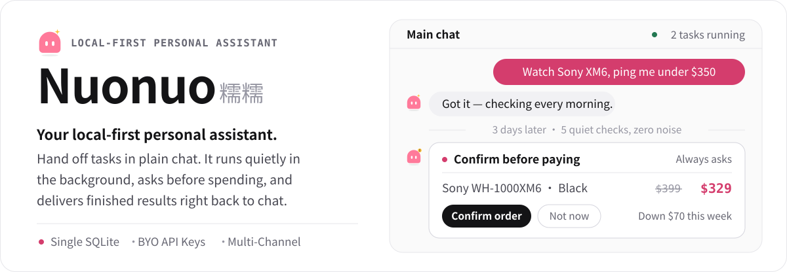
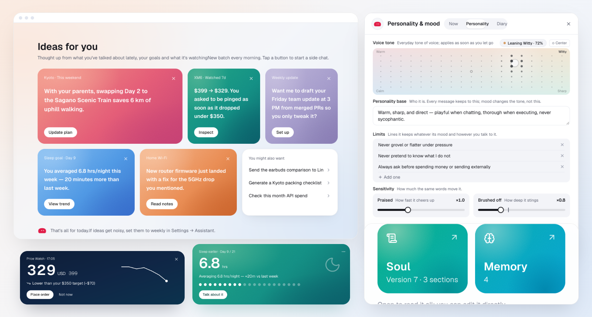

<div align="center">

<picture>
  <source media="(prefers-color-scheme: dark)" srcset="docs/assets/readme/hero-en-dark.svg" />
  
</picture>

<br />

[](https://github.com/cyDione/nuonuo/actions/workflows/ci.yml)
[](https://github.com/cyDione/nuonuo/releases)

[](LICENSE)

**English** · [简体中文](README.zh-CN.md) &nbsp;&nbsp;|&nbsp;&nbsp; [Install Guide](docs/INSTALL.md) · [中文安装教程](docs/INSTALL.zh-CN.md)

[Inside v0.4](#inside-v04) · [Quick Start](#quick-start) · [Architecture](#architecture) · [Acknowledgments](#acknowledgments) · [License](#license) · [Friendly Links](#friendly-links)

<br />


<sub>Live v0.4 walkthrough: ask once in Main chat → instant reply while a Worker checks weather and builds an interactive webpage in the background → inspect steps and preview the finished page inline.</sub>

</div>

<br />

**Nuonuo (糯糯)** is a self-hosted personal assistant built to feel calm rather than noisy. Run one lightweight **headless `/v1` server** on your machine or VPS, connect from a thin macOS app, web browser, or your existing chat tools, and delegate work in plain language. Your data, SQLite state, local Markdown memory, and API keys stay completely on hardware you own.

| Principle | How Nuonuo works |
| --- | --- |
| **Chat stays human** | Always-on **Main chat** for conversation, isolated **Side chats** for tasks. Tool logs stay in the right **Activity** pane; results come back clean. |
| **Server & clients decoupled** | One Node.js `/v1/*` server (headless by default, `--web` or Docker optional). Thin clients pair via QR, `scrypt` password, or Passkeys with rotating tokens. |
| **Boundaries in code, not prompts** | The Router mounts **zero shell tools**. Realpath folder limits, secret scrubbing, and spend/delete confirmations are enforced at runtime. |
| **Memory you can read** | `SOUL.md` and `MEMORY.md` live as local Markdown with version rollback, vector recall, and a trust gate that holds external or heated remarks in *Pending*. |

---

## Inside v0.4

### Workspace & Approvals

<p align="center">
  
</p>

A floating pill rail, collapsible in-flow conversation drawer, and ceramic right pane keep multiple background Workers visible without cluttering the thread. Whenever an action spends money, sends messages externally, or performs destructive edits, execution pauses on a plain-language confirmation card. Multi-tab `BroadcastChannel` sync with `navigator.locks` and hardened `/v1/events` SSE keep every open window coherent and instantaneous.

### Decoupled Auth, Guardrails & Cloud Browser

<p align="center">
  
</p>

- **Unified `/v1/*` Protocol 2.0**: Default-deny 6-scope RBAC (`chat`, `notices`, `approvals`, `tasks:read`, `tasks:write`, `admin`), single-use rotating refresh tokens with full family revocation on replay, and one-click local or Docker deployment right from the thin desktop app. On macOS, desktop tokens encrypt via `AES-256-GCM` + a mode-`0600` key file (`vault.key`) with zero Keychain password prompts.
- **Hard-coded limits & live takeover**: Folder permissions resolve symlinks before checking (`~/.ssh`, `~/.gnupg`, and OS keychains stay locked out). Run Workers locally, inside Docker, or on a [Cloud Computer](docs/13-computers.md) (such as [Instabox](plugins/instabox)) — watch live headed Chromium in the **Browser** pane and click **Take over** for 60fps control during login or 2FA.
- **One assistant everywhere**: Web, macOS desktop (`⌘⇧Space` Quick Ask), Telegram, Feishu/Lark, Discord, WeCom, DingTalk, Slack, GitHub (`@` in Issues/PRs), Gmail, Google Calendar, macOS native Reminders/Notes/Calendar, and custom [`@nuonuo/client`](packages/client) apps.

### Proactive Rhythm, 2D Voice Tone & Local Memory

<p align="center">
  
</p>

- **Two-stage filtering**: External sources pass deterministic rules first and a fast filter model second — noise drops silently, while real changes surface in **Feed**, morning **Ideas**, and long-running **Goals**.
- **Split-Phase Voice & 2D Tone Pad**: A tool-free Voice layer turns replies into coherent spoken bubbles shaped by a draggable 2D tone matrix (*Warm · Witty · Calm · Sharp*) and four live mood gauges (**Mood · Energy · Patience · Trust**).
- **Live self-configuration**: Ask Nuonuo in chat to adjust its theme, tone, quiet hours, or 12-layer model routing; updates sync live over SSE while security rules remain strictly owner-only.

---

## Quick Start

> Full deployment options, HTTPS reverse proxy / SSH tunnels, Docker sandbox, and troubleshooting live in **[docs/INSTALL.md](docs/INSTALL.md)** ([中文教程](docs/INSTALL.zh-CN.md)).

### 1. Start a Standalone Server

```sh
# Linux (x64 / arm64)
curl -fsSL https://raw.githubusercontent.com/cyDione/nuonuo/main/install.sh | bash

# macOS standalone server CLI (arm64 / x64)
curl -fsSL https://raw.githubusercontent.com/cyDione/nuonuo/main/install.sh | bash -s -- --server

# Start headless /v1 API (add --web to also serve the built-in WebUI) & issue a QR pairing code
nuonuo start -d --web
nuonuo pair --admin --qr
```

Or run with **Docker**:

```sh
NUONUO_WEB=1 docker compose up -d
docker exec -it nuonuo-server nuonuo pair --admin --qr
```

### 2. Install the Thin macOS Desktop App

Auto-detects Apple Silicon / Intel and installs `Nuonuo.app` into `/Applications` (manual `.dmg` packages are on **[GitHub Releases](https://github.com/cyDione/nuonuo/releases)**):

```sh
curl -fsSL https://raw.githubusercontent.com/cyDione/nuonuo/main/install.sh | bash
```

Open `Nuonuo.app`, scan the QR code or paste your pairing code — or click **Deploy locally in one click** to spin up a server on demand. On first sign-in, Nuonuo walks you through adding an API key (Anthropic, OpenAI, Gemini, DeepSeek, OpenRouter, Ollama, LM Studio, or any OpenAI-compatible gateway) right in chat.

> [!IMPORTANT]
> Do not run the server as `root`. `v0.4.0` publishes Linux/macOS servers and macOS desktop packages; other desktop targets can be built from source (`pnpm --filter @nuonuo/desktop dist:win`).

<details>
<summary><strong>Essential CLI Reference</strong></summary>

```sh
nuonuo start -d [--web]                  # start server (headless default; --web enables WebUI)
nuonuo pair --admin --qr                 # generate a 10-min one-time pairing code & QR
nuonuo auth set-password <pass>          # set an Owner password (scrypt)
nuonuo config --host 0.0.0.0 --web on    # persist host, port, and WebUI switch
nuonuo devices [list | revoke <id>]      # manage paired devices
nuonuo sessions [list | revoke <id>]     # inspect or terminate active sessions
nuonuo doctor | update | service install # diagnose, upgrade, or register autostart
```

</details>

Any device can connect via `nuonuo pair` over the unified [`/v1/*` Protocol 2.0](docs/11-client-protocol.md) and the standalone [`@nuonuo/client`](packages/client) TypeScript SDK ([examples](examples/clients)); build custom sources, chat channels, tools, skills, or cloud computers using the [Plugin SDK](docs/04-plugin-sdk.md) and [Channels Guide](docs/12-channels.md).

---

## Architecture

Nuonuo runs as a single decoupled daemon process — **one Node.js server, one SQLite database, and one human-readable data folder (`~/.nuonuo`)** — serving every thin client over unified `/v1/*`.

<p align="center">
  <picture>
    <source media="(prefers-color-scheme: dark)" srcset="docs/assets/readme/arch-en-dark.svg" />
    
  </picture>
</p>

- **Decoupled Server & Unified `/v1/*` Protocol 2.0**: The daemon runs headless by default (`--web` or Docker optional), while `apps/web`, `apps/desktop`, and `@nuonuo/client` carry zero internal backend dependencies. The auth kernel enforces default-deny **6-scope RBAC** (`chat`, `notices`, `approvals`, `tasks:read`, `tasks:write`, `admin`), QR pairing, `scrypt` passwords, WebAuthn Passkeys, and single-use rotating refresh tokens with full family revocation on replay.
- **Router / Worker Split & 12 Model Layers**: An always-on **Router** runs on a fast model and structurally mounts **zero shell or file execution tools** — it replies immediately, dispatches work, summarizes outcomes, and handles safe self-configuration. Heavy execution spawns isolated parallel **Workers** (and nested Subagents) on stronger models across up to **12 configurable layers** (`router`, `voice`, `worker`, `subagent`, `filter`, `reviewer`, `watchdog`, `summarizer`, `embedding`, `vision`, `transcribe`, `speech`), each with independent fallbacks and daily budgets.
- **Split-Phase Voice & Sideband Memory**: Phase A (Router brain) handles tool calls, routing, and mood updates; Phase B (Voice layer) renders tool-free conversational bubbles. Memory extraction runs asynchronously when chat goes idle, and non-owner sources or heated turns are gated into *Pending* so replies never block and long-term memory stays trustworthy.
- **Unified Triggers, Two-Stage Filtering & Subscription Bypass**: Chat messages, GitHub activity, Gmail, routines, and plugins all normalize into `Trigger`s; external noise is filtered by deterministic **Fast Path** rules followed by a lightweight **Slow Path** model. Once a Worker claims a thread, follow-up events route straight to it without waking the Router.
- **Stateless Loop, Inline & Spill & Crash Recovery**: Every turn rebuilds context from SQLite's event stream while oversized tool outputs spill to disk blobs fetched on demand via `recall()`. On restart, in-flight sessions recover, orphaned background jobs are cleaned up, and a persistent outbox prevents duplicate notifications or external comments.
- **Full-Duplex Execution, External Watchdog & Plugin Sandbox**: New owner messages inject cleanly between reasoning steps and long commands move automatically to background jobs. An independent **Watchdog** probes every minute to nudge, restart, or escalate stalled tasks — and self-heal an unresponsive Router. Third-party plugins run in isolated sandbox processes via the [Plugin SDK](docs/04-plugin-sdk.md) and can never shadow built-in tools.

<details>
<summary><strong>Monorepo Layout &amp; Local Development</strong></summary>

Dependencies flow strictly downward (guarded automatically by `apps/daemon/src/harness.test.ts`):

```text
apps/daemon             Headless-first server: /v1/* Hono API, RBAC + multi-auth, SSE, CLI
apps/web                Decoupled React 19 + Vite + Tailwind CSS 4 UI (zero @nuonuo/* deps, ZH/EN i18n)
apps/desktop            Thin Electron client: bundled web UI, AES-256-GCM/safeStorage vault, Local Deploy
packages/client         Standalone TypeScript SDK for /v1/* Protocol 2.0
packages/core           Domain engine: Trigger / Thread / Ticket / Subscriptions, Router & Worker,
                        Split-Phase Voice, Reviewer, Memory, Goals, Ideas, Watchdog
packages/agent-runtime  Agent loop: SQLite event log, mid-step injection, background jobs,
                        file / shell / Playwright browser / MCP tools, blob spill & recall
packages/sources        Source & Channel protocols, GitHub, Cron routines, Plugin Sandbox,
                        Cloud Computer shared layer & headed browser daemon
packages/plugins        Built-in plugins: Telegram, Feishu, Discord, WeCom, DingTalk, Slack, Gmail, Mood
packages/plugin-sdk     Third-party Plugin SDK
packages/models         Providers, encrypted secret store, 12-layer routing, usage ledger
packages/db             SQLite + Drizzle ORM, migrations, persistent side-effect outbox
plugins/instabox        Reference third-party Cloud Linux Desktop plugin
evals/                  Zero-token offline prompt, voice, and guardrail eval suite
examples/               Client & plugin examples (Python, Node.js, curl, RSS watch, Notes UI)
```

```sh
pnpm install && pnpm dev    # daemon + Vite HMR
pnpm check                  # 11-workspace typecheck + Vitest guardrails/unit tests + builds
pnpm eval                   # zero-token offline prompt & voice regression suite
```

Wrap any new UI copy with `tx()` and add its English entry in `apps/web/src/i18n.en.ts`. Architecture guardrails live in [`AGENTS.md`](AGENTS.md); design history lives in [`docs/`](docs/).

</details>

---

## Acknowledgments

- **DeepSeek — *"Super-agent Design Exploration"* & [dsh-superagent-prototype](https://github.com/deepseek-ai/dsh-superagent-prototype) (MIT)**: Inspired Nuonuo's two-tier Router/Worker architecture, two-stage event filtering, subscription bypass, Inline & Spill with `recall()`, full-duplex mid-step injection, stateless crash recovery, and external Watchdog. Core domain concepts (`Source` / `Trigger` / `Thread` / `Ticket` / `Policy`) were adapted from the MIT prototype; the agent runtime, auth/protocol kernel, model hub, plugin sandbox, voice/mood engine, cloud desktop layer, and decoupled web/desktop clients are independent implementations. See [Architecture Comparison](docs/07-architecture.md) and [Initial Research](docs/00-research.md).
- **[Muse](https://muse.ai/blog/how-we-designed-muse) & Grok Bot**: Inspired the main-chat + side-chat interaction model, background goal tracking, named assistant identity and mood, plain-language approval cards, and inline result previews. See [Design Notes](docs/09-m6-muse-and-memory.md).
- **Open-Source Ecosystem**: Built with Node.js 22, [Hono](https://hono.dev), SQLite & [Drizzle ORM](https://orm.drizzle.team), React 19, Vite, Tailwind CSS 4, [Vercel AI SDK](https://ai-sdk.dev), [Model Context Protocol (MCP)](https://modelcontextprotocol.io), Playwright, and Electron.

---

<p align="center">
  <a href="https://github.com/oil-oil/beautify-github-readme">
    <picture>
      <source media="(prefers-color-scheme: dark)" srcset="docs/assets/readme/made-with-beautify-dark.svg" />
      
    </picture>
  </a>
</p>

## License

Released under the **[MIT License](LICENSE)**.

---

## Friendly Links

- **[LINUX DO](https://linux.do/)** — A welcoming, sincere technical community for open sharing and thoughtful discussion, where Nuonuo's updates and feedback threads are also shared.
