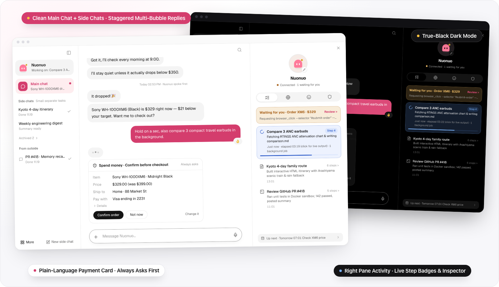
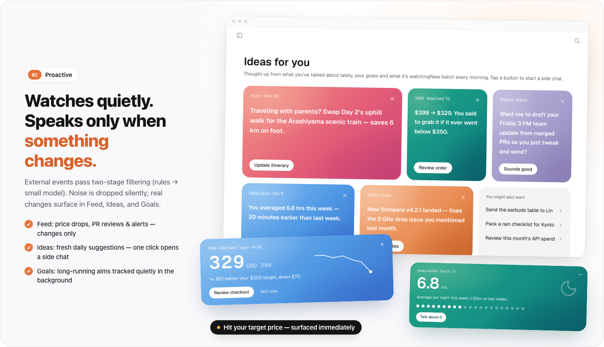
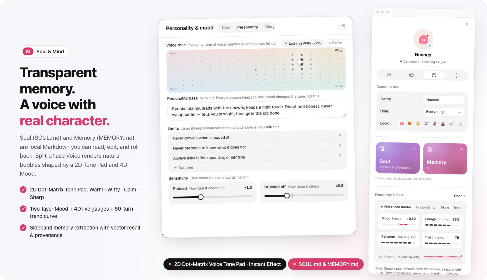
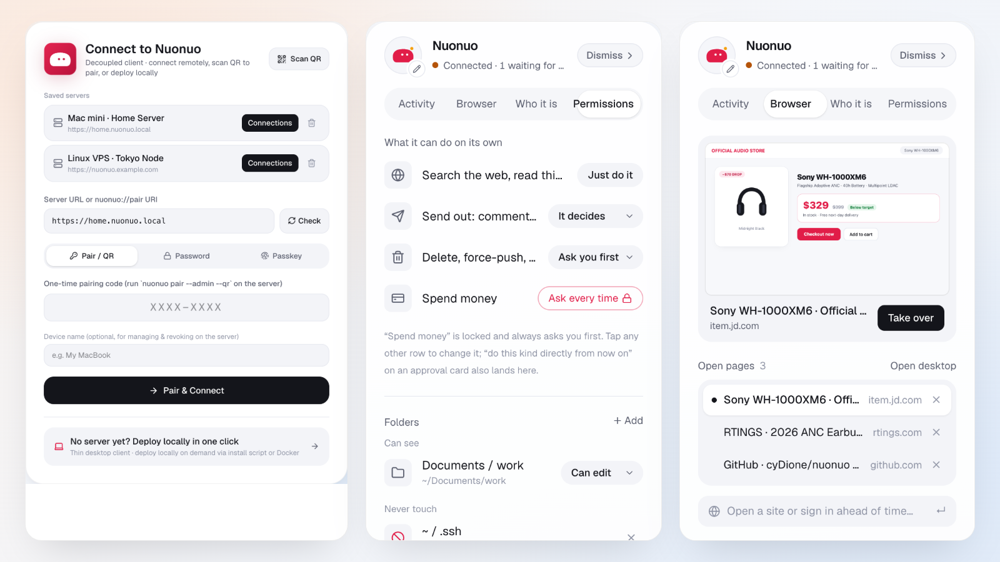
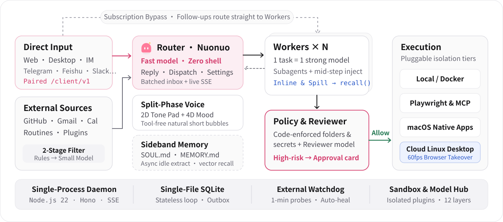

<div align="center">

<picture>
  <source media="(prefers-color-scheme: dark)" srcset="docs/assets/readme/hero-en-dark.svg" />
  
</picture>

<br />

[](https://github.com/cyDione/nuonuo/actions/workflows/ci.yml)
[](https://github.com/cyDione/nuonuo/releases)

[](LICENSE)

**English** · [简体中文](README.zh-CN.md) &nbsp;|&nbsp; [Install Guide (EN)](docs/INSTALL.md) · [中文安装教程](docs/INSTALL.zh-CN.md)

[Features & Screenshots](#features--screenshots) · [Quick Start](#quick-start) · [Architecture](#architecture) · [Acknowledgments](#acknowledgments) · [License](#license) · [Friendly Links](#friendly-links)

<br />


<sub>Real screen recording (wait intervals sped up): one message asks Nuonuo to plan a weekend Hangzhou trip — it checks the weather, builds a webpage in the background, and opens the finished preview right inside chat.</sub>

</div>

<br />

**Nuonuo (糯糯)** is a **local-first, proactive personal assistant** that runs on your own machine. Hand off a task in plain conversation — research a topic, watch a product price, triage repository issues, organize local files, or build a weekend itinerary webpage — and Nuonuo replies right away while parallel Workers finish the job in the background and return clean deliverables to your chat.

The daemon, SQLite state, local Markdown memory, and execution all live on your hardware using your own API keys (Anthropic, OpenAI, Gemini, DeepSeek, OpenRouter, Ollama, LM Studio, or any OpenAI-compatible gateway). When you aren't messaging it, Nuonuo watches your connected sources at the proactivity level you choose, filters out noise silently, and speaks up only when something actually changes.

---

## Features & Screenshots

<sub>All screenshots below are captured directly from the live Nuonuo web interface with sample data. Light and true-black dark themes follow your system or preference.</sub>

### 1. Clean Chat, Parallel Workers & Split-Pane Step Inspector

<p align="center">
  
</p>

- **Human conversation stays clean**: Your **Main chat** stays always-on while self-contained tasks live in **Side chats**. Tool logs never spam the chat thread — running progress, step badges, elapsed timers, and a **split-pane Step Inspector** stay tucked in the right **Activity** pane, and you can chime in mid-task anytime.
- **Natural messaging UX**: Drag, paste, or attach files; quote-reply, edit, recall, or regenerate answers; search all chats, results, and memories with `⌘K` / `Ctrl+K` (or `⌘F` in-chat); preview generated HTML pages, tables, and documents inline.
- **Plain-language approval cards**: Anything that spends money, sends messages externally, or performs destructive edits stops and surfaces a clear confirmation card — never buried in raw shell flags.

### 2. Proactive Intelligence: Feed, Daily Ideas & Long-Running Goals

<p align="center">
  
</p>

- **Two-stage event filtering**: Incoming external events pass deterministic **Fast Path** rules first, then a lightweight **Slow Path** model guided by your natural-language strategy. Noise is dropped silently; real changes surface in **Feed** (with 👍 / 👎 / bookmark controls).
- **Daily Ideas**: Each morning (or week), Nuonuo proposes concrete follow-ups drawn from recent chats, goals, and watched changes — one tap opens a Side chat and gets to work.
- **Background Goals**: Hand off a long-term goal in chat (e.g., *"I want to sleep earlier"*); Nuonuo tracks progress, suggests small milestones, and checks in on your cadence.

### 3. Transparent Markdown Memory, Soul & 2D Voice Tone

<p align="center">
  
</p>

- **Readable, editable Markdown**: Persona instructions (`SOUL.md`, with version history & rollback) and long-term memory (`MEMORY.md`, with original quote provenance and on-demand vector recall) are plain local files. On first launch, you can import memories from other AI tools.
- **Split-Phase Voice & 2D Tone Pad**: A dedicated, tool-free **Voice** layer turns replies into crisp, staggered spoken bubbles shaped by an interactive **2D dot-matrix Tone Pad** (*Warm · Witty · Calm · Sharp*) — drag anywhere and hear the shift on the very next turn.
- **Two-layer Mood with firm boundaries**: Four live dimensions (**Mood · Energy · Patience · Trust**), a slow-moving undertone, and a first-person diary shape *how* Nuonuo talks without ever compromising work quality. Heated offhand remarks enter *Pending confirmation* instead of polluting long-term memory.
- **Live self-configuration**: Ask Nuonuo in chat to tweak its theme, tone, model layers, quiet hours, or persona — changes sync across open windows immediately via SSE while security settings remain strictly owner-only.

### 4. Multi-Channel Reach, Hard-Coded Guardrails & Cloud Browser Takeover

<p align="center">
  
</p>

- **One assistant across every channel**: Web, macOS / Windows desktop apps (`⌘⇧Space` Quick Ask), **Telegram**, **Feishu / Lark**, **Discord**, **WeCom**, **DingTalk**, **Slack**, **GitHub** (`@` directly in Issues / PRs), **Gmail**, **Google Calendar**, macOS native **Reminders / Notes / Calendar**, plus custom paired devices over `/client/v1`. Replies always return where you messaged from.
- **Guardrails enforced in code, not prompts**: The always-on Router has **zero shell tools**. Folders are enforced after symlink resolution (**Read only / Can edit / Never touch**), with `~/.ssh`, `~/.gnupg`, and OS keychains locked out by default. Spending and deletion always ask you first; API keys are encrypted and stripped from Worker environments.
- **Docker sandbox & Cloud Linux Desktop**: Run tasks locally, inside a mounted Docker container, or on an isolated [Cloud Computer](docs/13-computers.md) (such as [Instabox](plugins/instabox)) with an X11 GUI desktop and persistent headed Chromium browsers. Inspect live pages in the right **Browser** pane and click **Take over** for 60fps interactive control whenever login, 2FA, or checkout needs you.

---

## Quick Start

> Looking for full setup, LAN / SSH access, Docker sandbox, source builds, upgrades, or CLI flags? Read the **[Full Installation & Deployment Guide](docs/INSTALL.md)** ([中文安装教程](docs/INSTALL.zh-CN.md)).

### macOS Desktop App

Auto-detects Apple Silicon / Intel, installs `Nuonuo.app` into `/Applications`, and upgrades cleanly when re-run:

```sh
curl -fsSL https://raw.githubusercontent.com/cyDione/nuonuo/main/install.sh | bash
```

### Windows Desktop App

Download the `x64` or `arm64` `setup.exe` (or portable `.zip`) from **[GitHub Releases](https://github.com/cyDione/nuonuo/releases)** — Node.js and the local daemon are bundled inside. (Manual macOS `.dmg` packages are also published on Releases.)

### Linux / Headless Server

Auto-detects `x64` / `arm64`, installs to `~/.local/share/nuonuo`, and starts in the background:

```sh
curl -fsSL https://raw.githubusercontent.com/cyDione/nuonuo/main/install.sh | bash
nuonuo start -d
```

Open the printed login link (`http://127.0.0.1:7420/auth?token=...`) in your browser. On first launch, Nuonuo walks you through adding an API key, connecting sources, and choosing a proactivity level right inside chat.

> [!IMPORTANT]
> Do not run Nuonuo as `root`. For stronger isolation, switch Docker sandbox to **All tasks** under **Settings → Security & execution** (or connect a Cloud Computer).

### Everyday Examples & Essential CLI

Talk to Nuonuo the way you message a teammate:
- *"Plan a 2-day Hangzhou trip for this weekend, check the weather, and turn it into a webpage."*
- *"Watch the Sony WH-1000XM6 and ping me if it drops under $350."*
- *"Triage new Issues in this repo and let me know only when something actually needs my input."*
- Drag a long PDF into chat: *"Pull out every clause I need to sign off on."*
- *"Every morning at 9 AM, pick the top technical posts from Hacker News worth reading."*

```sh
nuonuo start -d              # start daemon in background (stop / restart / status)
nuonuo token [--rotate]      # print or rotate the authenticated login URL
nuonuo doctor                # inspect Node.js, secrets store, models, git/gh, Docker
nuonuo update [--check]      # check or install the latest Linux release
nuonuo service install       # enable login autostart (launchd / systemd --user)
nuonuo pair                  # generate a 10-min pairing code for /client/v1 devices
nuonuo channel new <name>    # scaffold a custom chat-channel plugin adapter
```

Extend Nuonuo with custom devices via [`/client/v1`](docs/11-client-protocol.md) + [`@nuonuo/client`](packages/client) ([examples](examples/clients)), or build sources, tools, skills, and cloud providers with the [Plugin SDK](docs/04-plugin-sdk.md) and [Channel Layer](docs/12-channels.md).

---

## Architecture

Nuonuo runs as a single local process — **one Node.js daemon, one SQLite database, and one human-readable data folder (`~/.nuonuo`)**.

<p align="center">
  <picture>
    <source media="(prefers-color-scheme: dark)" srcset="docs/assets/readme/arch-en-dark.svg" />
    
  </picture>
</p>

- **Router / Worker Split**: An always-on **Router** uses a fast model and structurally mounts **zero shell tools** — it replies immediately, dispatches work, and summarizes outcomes. Heavy execution spawns isolated parallel **Workers** (and nested Subagents) on stronger models. Up to **12 specialized model layers** (`router`, `voice`, `worker`, `subagent`, `filter`, `reviewer`, `watchdog`, `summarizer`, `embedding`, `vision`, `transcribe`, `speech`) can be configured individually with fallbacks and daily budgets.
- **Split-Phase Voice & Sideband Memory**: Phase A (Router brain) handles tool calls, routing, and mood updates; Phase B (Voice layer) renders tool-free conversational bubbles. Memory extraction runs asynchronously when chat goes idle so replies never block.
- **Unified Triggers & Subscription Bypass**: Chat messages, GitHub activity, Gmail, routines, and plugins all normalize into `Trigger`s. Once a Worker claims a thread, subsequent events on that thread route straight to the subscribed Worker without waking the Router.
- **Stateless Loop & Crash Recovery**: Every turn rebuilds context from SQLite's event stream; oversized tool outputs spill to disk blobs and are fetched on demand via `recall()`. On restart, in-flight sessions recover, orphaned child processes are cleaned up, and a persistent outbox prevents duplicate notifications or external comments.
- **Full-Duplex Execution & External Watchdog**: New owner messages inject between reasoning steps, long commands move automatically to background jobs, and an independent **Watchdog** probes every minute to nudge, restart, or escalate stalled tasks — and self-heal an unresponsive Router.

<details>
<summary><strong>Repository Layout &amp; Local Development</strong></summary>

```text
apps/daemon             Local service: Hono HTTP API, SSE event stream, CLI
apps/web                Frontend: React 19 + Vite + Tailwind CSS 4 (bilingual ZH/EN i18n)
apps/desktop            Electron desktop app: tray, notifications, global Quick Ask
packages/core           Domain engine: Trigger / Thread / Ticket / Subscriptions, Router & Worker,
                        Split-Phase Voice, Reviewer, Memory, Goals, Ideas, Watchdog
packages/agent-runtime  Agent loop: SQLite event log, mid-step injection, background jobs,
                        file / shell / Playwright browser / MCP tools, blob spill & recall
packages/sources        Source & Channel protocols, GitHub, Cron routines, Plugin Sandbox,
                        Cloud Computer shared layer & headed browser daemon
packages/plugins        Built-in plugins: Telegram, Feishu, Discord, WeCom, DingTalk, Slack, Gmail, Mood
packages/plugin-sdk     Third-party Plugin SDK
packages/models         Model providers, encrypted secret storage, 12-layer routing, usage ledger
packages/db             SQLite + Drizzle ORM, migrations, persistent side-effect outbox
packages/client         TypeScript client SDK for /client/v1 paired devices
plugins/instabox        Reference third-party plugin: Instabox Cloud Linux Desktop
examples/               Client & plugin examples (Python, Node.js, curl, RSS watch, Notes UI)
```

```sh
pnpm install && pnpm dev    # run daemon + Vite HMR together
pnpm check                  # typecheck + tests + production build
```

Wrap any new UI copy with `tx()` and add its English entry in `apps/web/src/i18n.en.ts`. Full design and architecture logs live in [`docs/`](docs/).

</details>

---

## Acknowledgments

- **DeepSeek — *"Super-agent Design Exploration"* & [dsh-superagent-prototype](https://github.com/deepseek-ai/dsh-superagent-prototype) (MIT)**: Inspired Nuonuo's two-tier Router/Worker architecture, two-stage event filtering, subscription bypass, Inline & Spill with `recall()`, full-duplex mid-step injection, stateless crash recovery, and external Watchdog. Core domain concepts (`Source` / `Trigger` / `Thread` / `Ticket` / `Policy`) were adapted from the MIT prototype; the agent runtime, model hub, plugin sandbox, voice/mood engine, cloud desktop layer, and web/desktop UI are independent implementations. See [Architecture Comparison](docs/07-architecture.md) and [Initial Research](docs/00-research.md).
- **[Muse](https://muse.ai/blog/how-we-designed-muse) & Grok Bot**: Inspired the main-chat + side-chat interaction model, background goal tracking, named assistant identity and mood, plain-language approval cards, and inline result previews. See [Design Notes](docs/09-m6-muse-and-memory.md).
- **Open-Source Ecosystem**: Built with Node.js 22, [Hono](https://hono.dev), SQLite & [Drizzle ORM](https://orm.drizzle.team), React 19, Vite, Tailwind CSS 4, [Vercel AI SDK](https://ai-sdk.dev), [Model Context Protocol (MCP)](https://modelcontextprotocol.io), Playwright, and Electron.

---

<p align="center">
  <a href="https://github.com/oil-oil/beautify-github-readme">
    <picture>
      <source media="(prefers-color-scheme: dark)" srcset="docs/assets/readme/made-with-beautify-dark.svg" />
      
    </picture>
  </a>
</p>

## License

Released under the **[MIT License](LICENSE)**.

---

## Friendly Links

- **[LINUX DO](https://linux.do/)** — A welcoming, sincere technical community for open sharing and thoughtful discussion, where Nuonuo's updates and feedback threads are also shared.
