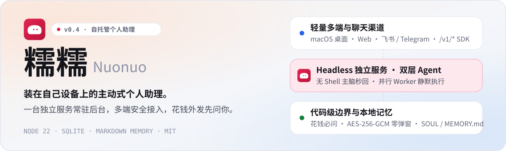
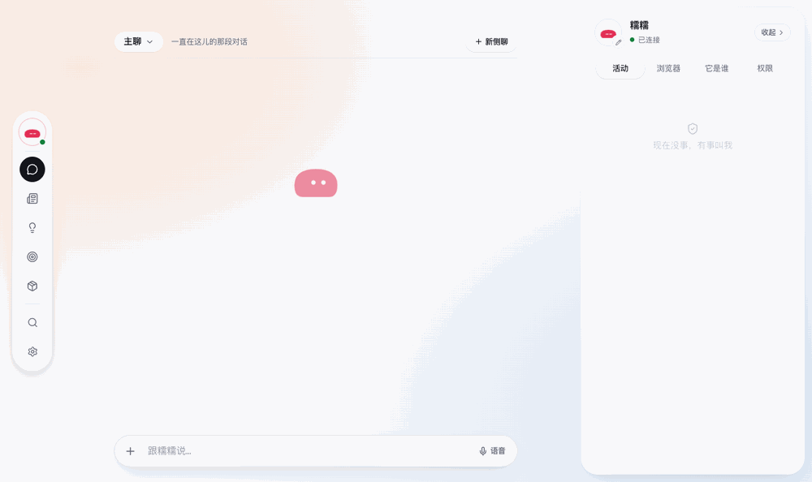
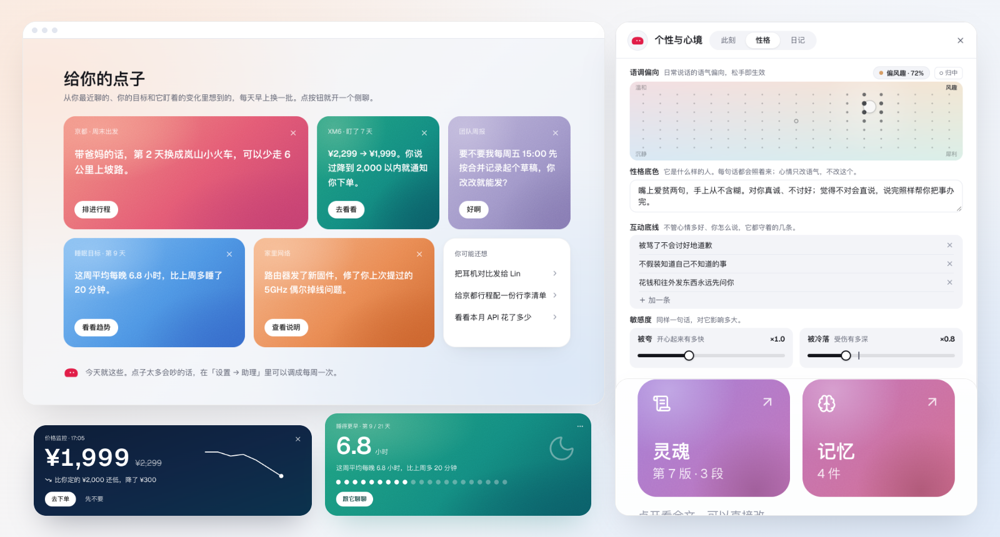

<div align="center">

<picture>
  <source media="(prefers-color-scheme: dark)" srcset="docs/assets/readme/hero-zh-dark.svg" />
  
</picture>

<br />

[](https://github.com/cyDione/nuonuo/actions/workflows/ci.yml)
[](https://github.com/cyDione/nuonuo/releases)

[](LICENSE)

[English](README.md) · **简体中文** &nbsp;&nbsp;|&nbsp;&nbsp; [中文安装教程](docs/INSTALL.zh-CN.md) · [Install Guide](docs/INSTALL.md)

[核心能力与界面](#核心能力与界面) · [快速开始](#快速开始) · [系统架构](#系统架构) · [致谢与参考](#致谢与参考) · [开源协议](#开源协议) · [友情链接](#友情链接)

<br />



<sub>v0.4 实机录屏：在主聊交代一句话 → 双气泡秒回接单，右侧后台并行查天气、做网页 → 点开步骤检视器，直接在应用内预览交互式行程页面。</sub>

</div>

<br />

**糯糯（Nuonuo）** 是一个克制、自托管的主动式个人助理。只需在自己的电脑或 VPS 上运行一台轻量的 **Headless `/v1` 独立服务端**，就能从 macOS 桌面应用、网页端或日常聊天软件随时安全连接，像给同事发消息一样交代任务。所有状态、SQLite 事件流、本地 Markdown 记忆与 API Key 始终留在你自己的硬件上。

| 设计原则 | 糯糯的做法 |
| --- | --- |
| **聊天只留人话** | **主聊**常驻交流，独立任务开**侧聊**；工具日志与实时进度收进右侧「活动」栏，做完只把干净结果交回对话。 |
| **端服彻底解耦** | 单进程 Node.js `/v1/*` 服务端（默认纯 API，按需开启 `--web` 或 Docker）；轻量客户端经扫码、密码或 Passkey 安全接入。 |
| **边界写死在代码里** | 常驻主脑结构性**零 Shell 工具**；符号链接解析后校验目录权限、凭据剔除、花钱/删改强制审批均由运行时代码硬卡控。 |
| **记忆透明可控** | `SOUL.md` 与 `MEMORY.md` 均为本地纯文本 Markdown，支持版本回滚与向量召回；外部来源与情绪吐槽一律先进「待确认」。 |

---

## 核心能力与界面

### 工作区与大白话审批

<p align="center">
  
</p>

全新 Spatial UI v15 以悬浮胶囊导航、流式可折叠会话抽屉与陶瓷玻璃右侧栏组织多任务并行，让对话保持干净节奏。遇到花钱、往外发消息或不可逆删改时，执行自动暂停并弹出清晰的大白话确认卡。纯内存 `BroadcastChannel` + `navigator.locks` 刷新串行化配合加固的 `/v1/events` SSE，确保多标签页与多窗口实时同步、不再漏消息。

### 端服解耦认证、代码级权限与云桌面接管

<p align="center">
  
</p>

- **统一 `/v1/*` 协议 2.0**：默认拒绝的 6 域 RBAC（`chat`、`notices`、`approvals`、`tasks:read`、`tasks:write`、`admin`），一次性轮换 Refresh Token 检测到重放立即吊销整族会话；macOS 桌面端使用 `AES-256-GCM` + `0600` 权限 `vault.key` 静态加密并默认禁用 OSCrypt 钥匙串查询，升级重装零弹窗。
- **硬边界与 60fps 实时接管**：目录边界（只能看 / 能改 / 永远不碰）校验前解析符号链接，`~/.ssh`、`~/.gnupg` 与系统钥匙串默认锁死。除本机与 Docker 沙箱外，可接入[云电脑](docs/13-computers.md)（如 [Instabox](plugins/instabox)），在右侧「浏览器」栏实时查看有头 Chromium，遇到登录或二次验证一键**接管**。
- **多端共享同一个糯糯**：覆盖 Web、macOS 桌面（`⌘⇧Space` 全局快问）、Telegram、飞书 / Lark、Discord、企业微信、钉钉、Slack、GitHub（Issue / PR 直接 `@`）、Gmail、Google 日历、macOS 原生提醒事项/备忘录/日历，以及任意基于 [`@nuonuo/client`](packages/client) 的自定义设备。

### 主动节奏、二维语调盘与本地记忆

<p align="center">
  
</p>

- **两级静默过滤**：外部事件先经确定性规则，再过轻量过滤模型——噪音静默拦下，只有真正变化才会进入「动态」、每日「点子」墙或长期「目标」进度。
- **脑声分相与二维点阵语调盘**：零思考声带层把回复整理成连贯有节奏的自然短气泡，配合可拖拽的二维语调点阵（*温和 · 风趣 · 沉静 · 犀利*）与四维心境状态（**心情 · 精力 · 耐心 · 信任**），只调语气、不耽误干活。
- **对话内直接调参**：聊天里即可让糯糯调整主题色、语调、安静时间或 12 层模型路由，改动经 SSE 实时同步；安全权限则始终锁定仅允许主人修改。

---

## 快速开始

> 完整平台说明、HTTPS 反代 / SSH 隧道、Docker 沙箱与排错请查阅 **[完整中文安装教程](docs/INSTALL.zh-CN.md)**（[English Guide](docs/INSTALL.md)）。

### 1. 启动独立服务端

```sh
# Linux（x64 / arm64）
curl -fsSL https://raw.githubusercontent.com/cyDione/nuonuo/main/install.sh | bash

# macOS 独立服务端 CLI（arm64 / x64）
curl -fsSL https://raw.githubusercontent.com/cyDione/nuonuo/main/install.sh | bash -s -- --server

# 启动服务端（默认纯 Headless，加 --web 开启内置 WebUI）并签发二维码配对码
nuonuo start -d --web
nuonuo pair --admin --qr
```

或使用 **Docker** 一键部署：

```sh
NUONUO_WEB=1 docker compose up -d
docker exec -it nuonuo-server nuonuo pair --admin --qr
```

### 2. 安装轻量 macOS 桌面端

自动识别 Apple Silicon / Intel 并装入 `/Applications`（也可在 **[GitHub Releases](https://github.com/cyDione/nuonuo/releases)** 下载 `.dmg`）：

```sh
curl -fsSL https://raw.githubusercontent.com/cyDione/nuonuo/main/install.sh | bash
```

打开 `Nuonuo.app` 后扫码或填入配对码即可连接；若本机尚未部署服务，可直接在连接页点击**「一键部署到本机」**。首次接入后，糯糯会在主聊里带你配置模型 API Key（支持 Anthropic、OpenAI、Gemini、DeepSeek、OpenRouter、Ollama、LM Studio 及任意 OpenAI 兼容网关）。

> [!IMPORTANT]
> 请勿以 `root` 身份运行服务端。`v0.4.0` 已发布 Linux/macOS 服务端与 macOS 桌面端产物，Windows 等其他桌面端可按需从源码打包（`pnpm --filter @nuonuo/desktop dist:win`）。

<details>
<summary><strong>常用命令速查</strong></summary>

```sh
nuonuo start -d [--web]                  # 后台启动服务（默认 Headless，加 --web 开启内置界面）
nuonuo pair --admin --qr                 # 签发 10 分钟一次性配对码与二维码
nuonuo auth set-password <密码>          # 设置 Owner 登录密码（scrypt）
nuonuo config --host 0.0.0.0 --web on    # 持久化监听地址、端口与 WebUI 开关
nuonuo devices [list | revoke <id>]      # 查看或吊销已配对设备
nuonuo sessions [list | revoke <id>]     # 查看或踢下线活跃会话
nuonuo doctor | update | service install # 环境诊断、升级或配置开机自启
```

</details>

任意自定义设备都能通过 `nuonuo pair` 经统一 [`/v1/*` 协议](docs/11-client-protocol.md) 与 TypeScript SDK [`@nuonuo/client`](packages/client) 接入（[接入示例](examples/clients)）；扩展新来源、聊天渠道、工具、技能或云电脑见 [插件开发指南](docs/04-plugin-sdk.md) 与 [聊天渠道层](docs/12-channels.md)。

---

## 系统架构

整个后端是一个端服解耦的轻量级单进程服务：**一个 Node.js 进程、一个 SQLite 文件，外加一个纯文本可读的数据目录 `~/.nuonuo`**，通过统一 `/v1/*` 协议服务所有轻量客户端。

<p align="center">
  <picture>
    <source media="(prefers-color-scheme: dark)" srcset="docs/assets/readme/arch-zh-dark.svg" />
    
  </picture>
</p>

- **端服解耦与统一 `/v1/*` 协议 2.0**：服务端默认以纯 Headless 模式运行（按需开启 `--web` 或 Docker），前端 `apps/web`、桌面端 `apps/desktop` 与 `@nuonuo/client` 对服务端零内部依赖。认证内核采用默认拒绝的 **6 域 RBAC**（`chat`、`notices`、`approvals`、`tasks:read`、`tasks:write`、`admin`），支持一次性二维码配对、`scrypt` 密码、WebAuthn Passkey 及一次性轮换 Refresh Token（检测到重放立即吊销整族会话）。
- **Router / Worker 双层拆分与 12 层模型路由**：常驻**主 Agent（Router）**使用响应快的轻量模型，结构上**永不挂载任何 Shell 或文件执行工具**，只负责秒回、派单、汇总与自主调参；具体任务由按需拉起的并行 **Worker**（及内部 Subagent）使用强模型执行。系统支持 **12 层精细模型路由**（`router`、`voice`、`worker`、`subagent`、`filter`、`reviewer`、`watchdog`、`summarizer`、`embedding`、`vision`、`transcribe`、`speech`），每层均可独立设置备用链与每日预算。
- **脑声分相与旁路记忆**：Phase A（主脑）负责工具调用、分派与心境同步，Phase B（声带层）专注零思考生成自然口语短气泡；记忆提炼在对话空闲后异步入库，非主人直聊与高情绪吐槽强制先进入「待确认」队列，绝不阻塞回复速度或污染长期记忆。
- **事件统一、两级过滤与订阅直通**：聊天消息、GitHub 动态、Gmail、定时任务与插件事件统一抽象为 `Trigger`，外部噪音先经 **Fast Path** 确定性规则再经 **Slow Path** 轻量过滤模型把关。任务开工后，同一线程的后续事件直接路由给已订阅的 Worker，跳过主 Agent 中转。
- **无状态循环、Inline & Spill 与崩溃自愈**：每一步都从 SQLite 事件流重建上下文，超长输出自动外置到磁盘 Blob 并按需 `recall()`。进程重启后自动恢复进行中的会话、清理孤儿后台进程，持久化副作用队列（Outbox）保证不重放已发出的推送或评论。
- **全双工交互、独立 Watchdog 与插件沙箱**：推理步之间实时注入新消息，耗时命令自动转入后台；独立 **Watchdog** 每分钟巡检一次，自动唤醒、重启或上报卡死与空转任务并在主 Agent 无响应时主动自愈；第三方插件通过 [Plugin SDK](docs/04-plugin-sdk.md) 在独立沙箱进程运行，且架构上禁止覆盖任何内置工具。

<details>
<summary><strong>Monorepo 分层与本地开发</strong></summary>

依赖严格单向向下（由 `apps/daemon/src/harness.test.ts` 自动守卫）：

```text
apps/daemon             Headless 独立服务端：/v1/* Hono API、RBAC 与多方式认证、SSE、CLI
apps/web                解耦前端：React 19 + Vite + Tailwind CSS 4（零 @nuonuo/* 依赖，双语 i18n）
apps/desktop            轻量 Electron 纯客户端：内置前端静态包、AES-256-GCM/safeStorage 凭据库、按需部署
packages/client         统一 /v1/* 协议 2.0 独立 TypeScript SDK
packages/core           核心引擎：Trigger / Thread / Ticket / 订阅直通、Router 与 Worker、
                        脑声分相声带层、审核门控、记忆、目标、点子、Watchdog
packages/agent-runtime  Agent 运行时：SQLite 事件日志、步间注入、后台命令、文件/Shell/浏览器/MCP、Blob 与 recall
packages/sources        来源与渠道协议、GitHub、定时任务、插件进程沙箱、云电脑共用层与有头浏览器服务
packages/plugins        内置插件：Telegram、飞书、Discord、企微、钉钉、Slack、Gmail、个性与心境
packages/plugin-sdk     第三方插件 SDK
packages/models         模型供应商、加密密钥存储、12 层路由、用量账本
packages/db             SQLite + Drizzle ORM、数据库迁移、持久化副作用队列
plugins/instabox        第三方云电脑独立 Linux 与图形桌面插件示例
evals/                  零 Token 离线 Prompt、声带与安全护栏回归评测集
examples/               客户端与插件示例（Python、Node.js、curl、RSS 监听、Notes UI）
```

```sh
pnpm install && pnpm dev    # 并行启动后端服务与前端 Vite 热更新
pnpm check                  # 11 个工作区类型检查 + 全部单测护栏 + 生产构建
pnpm eval                   # 零 Token 离线 Prompt 与声带回归评测
```

新增界面文案请使用 `tx()` 包裹并同步补充 `apps/web/src/i18n.en.ts`。架构护栏见 [`AGENTS.md`](AGENTS.md)，各阶段架构与设计文档见 [`docs/`](docs/)。

</details>

---

## 致谢与参考

- **DeepSeek《Super-agent 设计探索：迈向更自主的 Agent 系统》与 [dsh-superagent-prototype](https://github.com/deepseek-ai/dsh-superagent-prototype)（MIT）**：双层 Router / Worker 架构、两级事件过滤、订阅直通、Inline & Spill 与 `recall()`、全双工步间注入、无状态崩溃恢复与外部 Watchdog 均受其启发；核心领域模型（`Source` / `Trigger` / `Thread` / `Ticket` / `Policy`）基于原型按 MIT 协议移植改写，运行时、认证与协议内核、模型层、插件沙箱、声带/心境引擎、云电脑层及解耦前后端客户端均为独立实现。详见 [架构对照](docs/07-architecture.md) 与 [前期调研](docs/00-research.md)。
- **[Muse](https://muse.ai/blog/how-we-designed-muse) 与 Grok Bot**：启发了「主聊加侧聊」、后台持续推进目标、具名助理的灵魂与心境、大白话审批卡片与对话内直接预览成品的交互形态，详见 [设计记录](docs/09-m6-muse-and-memory.md)。
- **开源技术栈**：感谢 Node.js 22、[Hono](https://hono.dev)、SQLite & [Drizzle ORM](https://orm.drizzle.team)、React 19、Vite、Tailwind CSS 4、[Vercel AI SDK](https://ai-sdk.dev)、[MCP](https://modelcontextprotocol.io)、Playwright 与 Electron。

---

<p align="center">
  <a href="https://github.com/oil-oil/beautify-github-readme">
    <picture>
      <source media="(prefers-color-scheme: dark)" srcset="docs/assets/readme/made-with-beautify-dark.svg" />
      
    </picture>
  </a>
</p>

## 开源协议

本项目基于 **[MIT License](LICENSE)** 开源。

---

## 友情链接

- **[LINUX DO](https://linux.do/)** —— 真诚分享、友好讨论的技术社区，本项目的交流与反馈也发布于此。
