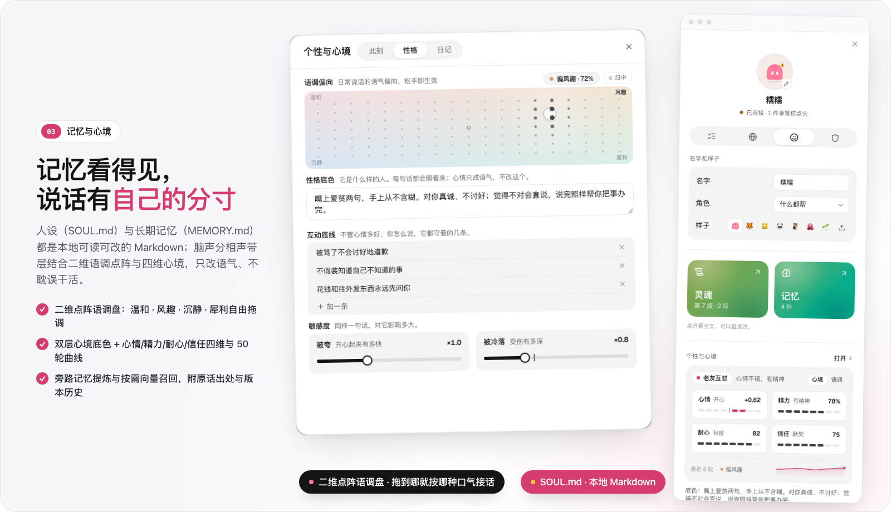
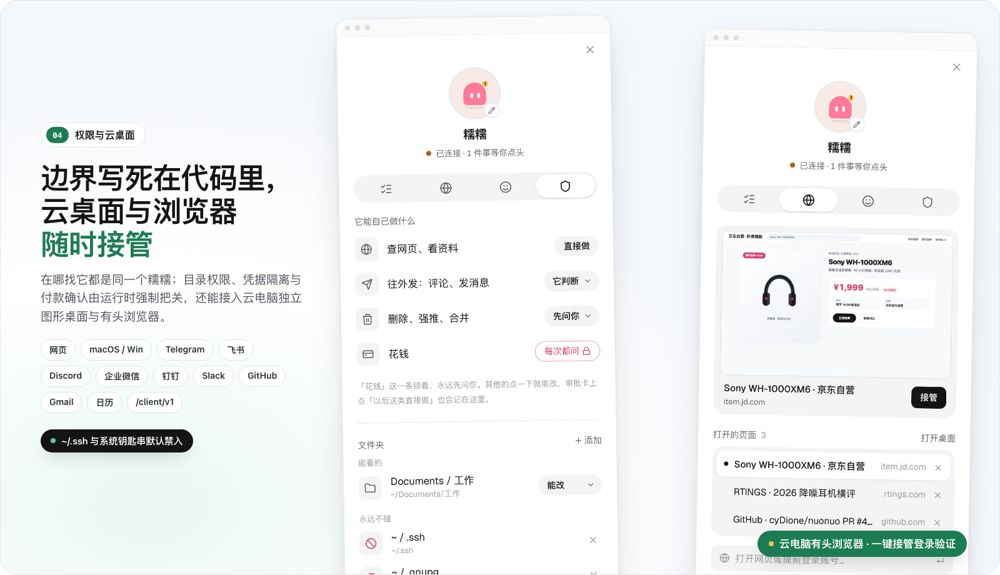
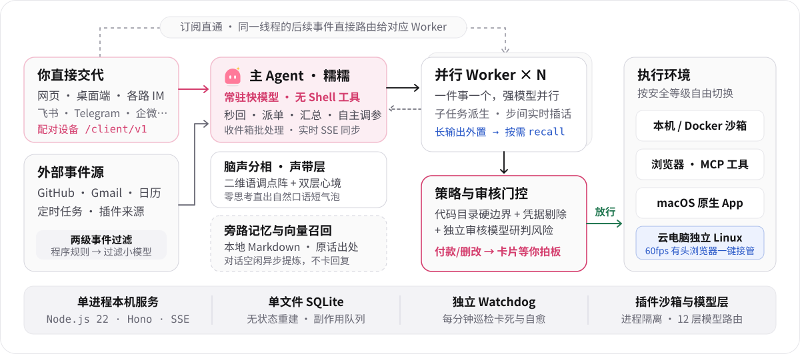

<div align="center">

<picture>
  <source media="(prefers-color-scheme: dark)" srcset="docs/assets/readme/hero-zh-dark.svg" />
  
</picture>

<br />

[](https://github.com/cyDione/nuonuo/actions/workflows/ci.yml)
[](https://github.com/cyDione/nuonuo/releases)

[](LICENSE)

[English](README.md) · **简体中文** &nbsp;|&nbsp; [中文安装教程](docs/INSTALL.zh-CN.md) · [Install Guide (EN)](docs/INSTALL.md)

[核心特点与截图](#核心特点与截图) · [快速安装](#快速安装) · [系统架构](#系统架构) · [致谢与参考](#致谢与参考) · [开源协议](#开源协议) · [友情链接](#友情链接)

<br />


<sub>实机录屏（等待部分已快进）：一句话交代排杭州周末两日行程，后台查完天气并做好网页，完成后直接在聊天里打开预览。</sub>

</div>

<br />

**糯糯（Nuonuo）** 是一个跑在你自己机器上的**主动式个人助理**。像给朋友发消息一样交代一件事——查资料、盯商品降价、跟进仓库 Issue、整理本地文件、排好行程做成网页——糯糯先秒回接单，再交给后台并行 Worker 悄悄办完，最后把成品直接交回聊天里，点开就能看。

服务、SQLite 数据、本地 Markdown 记忆和任务执行都在你自己的设备上运行，模型填你自己的 API Key（支持 Anthropic、OpenAI、Gemini、DeepSeek、OpenRouter、Ollama、LM Studio 及任意 OpenAI 兼容网关）。平时没人找它，它也会按你设定的主动程度留意邮件、日历、GitHub 和订阅来源，静默筛掉噪音，只在真有变化时开口。

---

## 核心特点与截图

<sub>以下截图均来自糯糯真实运行的最新界面（使用示例数据），浅色与纯黑深色模式自动跟随系统或手动切换。</sub>

### 1. 对话干净、多任务并行与分栏步骤检视

<p align="center">
  
</p>

- **聊天只留人话，执行收进侧栏**：**主聊**常驻，独立任务开**侧聊**，互不串线。工具调用日志不会刷屏对话，执行进度、实时步骤徽章、耗时计时与**分栏步骤检视器**全部收在右侧「活动」栏，干活中途随时可以插话补充。
- **像常用聊天软件一样顺手**：支持拖拽/粘贴发文件、引用回复、编辑、撤回重答，支持 `⌘K` / `Ctrl+K` 全局搜索全部对话/成果/记忆（以及对话内 `⌘F` 查找），生成的网页、表格与文档直接在对话内预览。
- **大白话审批卡片**：凡涉及花钱、往外发消息或不可逆删改，都会停下来弹出清晰易懂的确认卡片，而不是丢给你一串难懂的命令行。

### 2. 主动留意：动态、每日点子与长期目标

<p align="center">
  
</p>

- **两级事件过滤，绝不瞎打扰**：外部消息先过 **Fast Path** 确定性规则，再交由轻量 **Slow Path** 过滤模型按你的自然语言策略把关。噪音静默拦截，只有真正的变化才会进入「动态」（支持 👍 / 👎 / 收藏反馈）。
- **给你的点子**：每天（或每周）结合近期对话、目标与盯盘变化主动想出一批顺手能做的提议，点一下按钮立刻开一个侧聊开工。
- **后台持续推进目标**：在聊天里说一句长期想法（例如「我想睡得更早」），糯糯会在后台持续记进度、拆解小目标，并按约定节奏和你对齐。

### 3. 透明的本地 Markdown 记忆、灵魂与二维语调盘

<p align="center">
  
</p>

- **看得见、改得动的本地记忆**：人设（`SOUL.md`，带历史版本与一键回滚）和长期记忆（`MEMORY.md`，带原话出处与按需向量召回）都是本地纯文本 Markdown；首次启动还可直接导入你在其他 AI 中攒下的记忆。
- **脑声分相与二维点阵语调盘**：独立的零思考**声带层**把回复草稿自然拆成有节奏的口语短气泡，配合交互式**二维点阵语调盘**（*温和 · 风趣 · 沉静 · 犀利*），手指拖到哪，下一句就按哪种口气接话。
- **双层心境与互动底线**：内置**心情 · 精力 · 耐心 · 信任**四维状态、慢衰减情绪底色与第一人称日记；情绪只改变说话姿态，从不耽误干活，气头上的狠话只会进入「待确认」而不会污染长期记忆。
- **聊天里直接调设置**：在对话里就能让糯糯修改主题色、语调、分层模型、安静时间或人设，前端通过 SSE 实时同步生效；安全与权限类配置仍严格锁定仅允许主人修改。

### 4. 多端合一、代码级权限边界与云桌面实时接管

<p align="center">
  
</p>

- **在哪找它都是同一个糯糯**：支持网页、macOS / Windows 桌面端（`⌘⇧Space` 全局快问）、**Telegram**、**飞书 / Lark**、**Discord**、**企业微信**、**钉钉**、**Slack**、**GitHub**（在 Issue / PR 里直接 `@` 派活）、**Gmail**、**Google 日历**、macOS 原生**提醒事项 / 备忘录 / 日历**，以及基于 `/client/v1` 的自定义配对设备。消息从哪发来，结果就回哪里。
- **边界写死在代码里，不靠提示词自觉**：常驻主 Agent 结构上**不挂载任何 Shell 工具**；文件夹按「只能看 / 能改 / 永远不碰」分级校验（先解析符号链接真实路径），`~/.ssh`、`~/.gnupg` 与系统钥匙串默认禁入；付款与删除每次必问，API Key 加密存储且从 Worker 环境变量中彻底剔除。
- **Docker 沙箱与云电脑独立图形桌面**：除本机与 Docker 容器沙箱外，还可接入[云电脑](docs/13-computers.md)（如 [Instabox](plugins/instabox)），让 Worker 在云端独立 Linux、`1280×800` X11 图形桌面与常驻有头 Chromium 里执行任务；随时从右侧「浏览器」栏查看实时画面，遇到登录、二次验证或支付时一键**接管** 60fps 交互流。

---

## 快速安装

> 需要完整平台说明、局域网 / SSH 访问、Docker 沙箱、源码构建、升级迁移或完整命令参数，请阅读 **[完整中文安装与部署教程](docs/INSTALL.zh-CN.md)**（[English Install Guide](docs/INSTALL.md)）。

### macOS 桌面端

自动识别 Apple Silicon / Intel，直接装入 `/Applications`，重复运行即升级：

```sh
curl -fsSL https://raw.githubusercontent.com/cyDione/nuonuo/main/install.sh | bash
```

### Windows 桌面端

从 **[GitHub Releases](https://github.com/cyDione/nuonuo/releases)** 下载 `x64` / `arm64` 版本的 `setup.exe`（或免安装 `.zip`），已内置后台服务与 Node.js，安装即用。（macOS 也可在此手动下载 `.dmg`。）

### Linux / 无桌面服务器

自动识别 `x64` / `arm64`，安装至 `~/.local/share/nuonuo` 并后台启动：

```sh
curl -fsSL https://raw.githubusercontent.com/cyDione/nuonuo/main/install.sh | bash
nuonuo start -d
```

打开终端打印的登录链接（`http://127.0.0.1:7420/auth?token=...`）即可进入界面。首次进入时，糯糯会在主聊里一步步带你填 API Key、连接来源并选择主动程度。

> [!IMPORTANT]
> 请勿以 `root` 身份运行服务。需要更强隔离时，可在 **设置 → 安全和执行** 中开启 Docker 沙箱（「所有任务」）或接入云电脑。

### 日常怎么用与常用命令

直接按平时说话的方式交代即可：
- 「帮我排一下这个周末去杭州的行程，查好天气做成网页」
- 「盯着京东自营的 Sony XM6，降到 2000 以内叫我」
- 「这个仓库有新 Issue 先帮我看一眼，确实要处理再告诉我」
- 把一份长 PDF 拖进聊天：「挑出里面需要我拍板的条款」
- 「每天早上 9 点帮我筛一遍 Hacker News 值得看的技术帖」

```sh
nuonuo start -d              # 后台启动服务（stop / restart / status 管理生命周期）
nuonuo token [--rotate]      # 查看或轮换带鉴权的登录链接
nuonuo doctor                # 检查 Node.js、密钥存储、模型配置、git/gh 与 Docker
nuonuo update [--check]      # 检查或自动安装最新 Linux 版本
nuonuo service install       # 配置开机自启（macOS launchd / Linux systemd --user）
nuonuo pair                  # 生成 10 分钟配对码，接入自定义手机/手表/音箱设备
nuonuo channel new <name>    # 生成自定义聊天渠道插件适配器脚手架
```

任何设备都能通过 `nuonuo pair` 经 [`/client/v1`](docs/11-client-protocol.md) 与 TypeScript SDK [`@nuonuo/client`](packages/client) 接入（[示例](examples/clients)）；扩展新来源、聊天渠道、工具、技能或云电脑见 [插件开发指南](docs/04-plugin-sdk.md) 与 [聊天渠道层](docs/12-channels.md)。

---

## 系统架构

整个后端是一个轻量级本机单进程服务：**一个 Node.js 进程、一个 SQLite 文件，外加一个纯文本可读的数据目录 `~/.nuonuo`**。

<p align="center">
  <picture>
    <source media="(prefers-color-scheme: dark)" srcset="docs/assets/readme/arch-zh-dark.svg" />
    
  </picture>
</p>

- **Router / Worker 双层拆分**：常驻**主 Agent（Router）**使用响应快的轻量模型，结构上**不挂载任何 Shell 工具**，只负责秒回、派单、汇总与自主调参；具体任务由按需拉起的并行 **Worker**（及内部 Subagent）使用强模型执行。系统支持 **12 层精细模型路由**（`router`、`voice`、`worker`、`subagent`、`filter`、`reviewer`、`watchdog`、`summarizer`、`embedding`、`vision`、`transcribe`、`speech`），每层均可独立设置备用链与每日预算。
- **脑声分相与旁路记忆**：Phase A（主脑）负责工具调用、分派与心境同步，Phase B（声带层）专注零思考生成自然口语短气泡；记忆提炼在对话空闲后异步入库，绝不阻塞回复速度。
- **事件统一与订阅直通**：聊天消息、GitHub 动态、Gmail、定时任务与插件事件统一抽象为 `Trigger`。任务开工后，同一线程的后续事件直接路由给已订阅的 Worker，跳过主 Agent 中转。
- **无状态循环与崩溃自愈**：每一步都从 SQLite 事件流重建上下文，长输出自动外置到磁盘 Blob 并按需 `recall()`。进程重启后自动恢复进行中的会话、清理孤儿后台进程，持久化副作用队列（Outbox）保证不重放已发出的推送或评论。
- **全双工交互与独立 Watchdog**：推理步之间实时注入新消息，耗时命令自动转入后台；独立 **Watchdog** 每分钟巡检一次，自动唤醒、重启或上报卡死与空转任务，并在主 Agent 无响应时主动自愈。

<details>
<summary><strong>代码目录与本地开发</strong></summary>

```text
apps/daemon             本机服务：Hono HTTP API、SSE 实时事件流、CLI
apps/web                前端界面：React 19 + Vite + Tailwind CSS 4（内置中英双语 i18n）
apps/desktop            桌面客户端：Electron 托盘、系统通知、全局快捷提问
packages/core           核心引擎：Trigger / Thread / Ticket / 订阅直通、主 Agent 与 Worker、
                        脑声分相声带层、审核门控、记忆、目标、点子、Watchdog
packages/agent-runtime  Agent 运行时：SQLite 事件日志、步间注入、后台命令、文件/Shell/浏览器/MCP、recall
packages/sources        来源与渠道协议、GitHub、定时任务、插件进程沙箱、云电脑共用层与有头浏览器服务
packages/plugins        内置插件：Telegram、飞书、Discord、企业微信、钉钉、Slack、Gmail、个性与心境
packages/plugin-sdk     第三方插件 SDK
packages/models         模型供应商、加密凭据存储、12 层模型路由、用量账本
packages/db             SQLite + Drizzle ORM、数据库迁移、持久化副作用队列
packages/client         /client/v1 配对设备 TypeScript SDK
plugins/instabox        第三方插件示例：Instabox 云电脑独立 Linux 与图形桌面
examples/               客户端与插件示例（Python、Node.js、curl、RSS 监听、Notes UI）
```

```sh
pnpm install && pnpm dev    # 同时启动后端服务与前端 Vite 热更新
pnpm check                  # 完整运行类型检查、测试与生产构建
```

新增界面文案请使用 `tx()` 包裹并同步补充 `apps/web/src/i18n.en.ts`。各阶段架构与设计记录见 [`docs/`](docs/)。

</details>

---

## 致谢与参考

- **DeepSeek《Super-agent 设计探索：迈向更自主的 Agent 系统》与 [dsh-superagent-prototype](https://github.com/deepseek-ai/dsh-superagent-prototype)（MIT）**：双层 Router / Worker 架构、两级事件过滤、订阅直通、Inline & Spill 与 `recall()`、全双工步间注入、无状态崩溃恢复与外部 Watchdog 均受其启发；核心领域模型（`Source` / `Trigger` / `Thread` / `Ticket` / `Policy`）基于原型按 MIT 协议移植改写，运行时、模型层、插件沙箱、声带/心境引擎、云电脑层及前后端界面均为独立实现。详见 [架构对照](docs/07-architecture.md) 与 [前期调研](docs/00-research.md)。
- **[Muse](https://muse.ai/blog/how-we-designed-muse) 与 Grok Bot**：启发了「主聊加侧聊」、后台持续推进目标、具名助理的灵魂与心境、大白话审批卡片与对话内直接预览成品的交互形态，详见 [设计记录](docs/09-m6-muse-and-memory.md)。
- **开源技术栈**：感谢 Node.js 22、[Hono](https://hono.dev)、SQLite & [Drizzle ORM](https://orm.drizzle.team)、React 19、Vite、Tailwind CSS 4、[Vercel AI SDK](https://ai-sdk.dev)、[MCP](https://modelcontextprotocol.io)、Playwright 与 Electron。

---

<p align="center">
  <a href="https://github.com/oil-oil/beautify-github-readme">
    <picture>
      <source media="(prefers-color-scheme: dark)" srcset="docs/assets/readme/made-with-beautify-dark.svg" />
      
    </picture>
  </a>
</p>

## 开源协议

本项目基于 **[MIT License](LICENSE)** 开源。

---

## 友情链接

- **[LINUX DO](https://linux.do/)** —— 真诚分享、友好讨论的技术社区，本项目的交流与反馈也发布于此。
