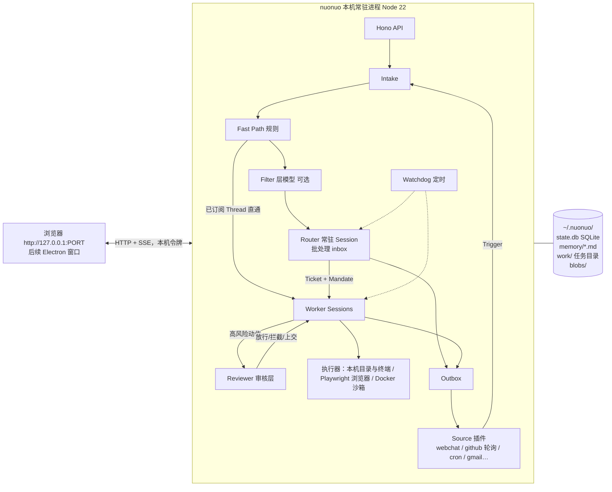

# Super-agent 调研报告与系统方案（v0.2：个人本地版）

> 资料来源：
> 1. DeepSeek《Super-agent 设计探索：迈向更自主的 Agent 系统》（知乎，2026-11-01）
> 2. `deepseek-ai/dsh-superagent-prototype`（MIT，约 3.7 万行 TS，基于 DeepSeek Harness 0.2.1-alpha）：已通读 docs/000–008、prompts/、src/core、src/sources/kind.ts、src/app/role-models.ts 等
>
> 3. 交互参照：Grok Bot（SpaceXAI × Cursor，常驻具名 Bot、各自的电脑与记忆、自然语言规则 + 审核 Agent、routine 触发器）、Meta Muse（muse.ai，以目标驱动、后台持续推进、跨任务记忆、Sentinel 审核关键动作）
>
> 目标（v0.2 修订）：**纯个人使用，服务端与执行端都运行在用户自己的机器上，暂不做 SaaS。** 首发形态是本机 Web 端对话，交互方式类似 Grok Bot / Muse；后续推出 Electron 客户端；插件化基座，首发接入 GitHub，后续支持自定义插件（例如 Gmail）；设置页支持 BYOK，并可给每一层分别配置执行模型。

---

## 0. 结论先行

1. **文章提出的不是新理论，而是一套把经典系统设计用到 Agent 上的工程框架。** 它由五个模块组成：双层架构（Router / Worker）、事件驱动（两级过滤、订阅直通、Inline & Spill、投机执行）、面向人的全双工多信道交互、存算与执行环境分离（BYOM daemon）、外部 Watchdog。四个目标特征分别是：连续、高效、主动、持久。
2. **DS 原型只实现了文章的一部分，而且是 DSH 内的一个 bundle**，不能直接拿来当产品底座：
   - 只服务单个 GitHub 仓库和单个团队，只接了 GitHub 和飞书两个来源，**没有 Web 对话来源**。
   - 用 `gh` / `lark-cli` 轮询，没有用 GitHub App + Webhook。
   - 状态存在 SQLite，单进程运行。
   - 未实现的部分：Watchdog、BYOM daemon、真正的异步 `start/stop` 工具（目前只是“shell 跑满 5 秒后自动转后台”）、多租户、BYOK。
   - 依赖的 `@deepseek-ai/dsh-*` / `cordis` 都还是 alpha / rc 版本。
3. **原型里真正值钱的是领域模型和规则**：Source / Trigger / Thread / Eval / Decision / Mandate / Ticket / Assignment / Subscription / Report，再加上 Policy 门控、Ticket 阶段表、持久化副作用队列（Effects）和 Outbox。这些概念经过实战打磨，边界很清楚。**建议：领域层按 MIT 协议移植并改写，运行时、模型层、插件层、客户端全部自研。**
4. **“对话”只是又一个 Source + Channel。** 用户在网页上的一条消息，就是一个 `addressed=direct` 的 Trigger；Agent 的回复就是写回 Channel。Web、Electron、GitHub、Gmail、IM 全部走同一条管线。
5. **个人本地版会让系统大幅简化。** 不需要多租户，不需要成员和 admission 表，不需要 Postgres，也不需要云沙箱集群。整个系统就是**一个本机常驻进程，加一个 SQLite 文件，加一个可以纯文本查看和编辑的数据目录**。GitHub 采用轮询（本机通常没有公网地址），这正好是 DS 原型现成的做法。
6. **交互参照 Grok Bot / Muse，并和文章架构对齐：**
   - 用户给目标，Agent 在后台推进，有结果或需要用户决定时才回来。
   - 每个对话是一个**话题或任务**，不是 Session；底层由 Router 和 Worker 自动映射。
   - Agent 可以**主动发起新对话**，用于投递结果或提醒。
   - 有一个“待你处理”收件箱，收纳批准请求、问题和需要用户接手的操作。
   - 记忆分三层：用户、Bot、项目。
   - 规则用自然语言书写，由**审核 Agent** 对动作做放行、拦截或上交给用户。
7. **在本机运行，安全的重心要换个地方。** Agent 直接动的是你的真机，所以重点不再是隔离不同租户，而是三件事：
   - **动作审核**：靠审核 Agent 和权限档位。
   - **来源分级**：外部来源（陌生人的 Issue、邮件）触发的任务默认进只读或 Docker 沙箱。
   - **凭据不进模型**：所有凭据由系统托管，模型在上下文里永远看不到。
8. **技术栈：全 TypeScript monorepo。**
   - 本机进程：Node 22 + Hono，数据库 SQLite + Drizzle。
   - 前端：React 19 + Vite。
   - 模型层：Vercel AI SDK v7。
   - 第三方工具：MCP。
   - 浏览器能力：Playwright，使用持久化的 profile。
   - Electron 后续直接把本机进程和 UI 一起打包。

---

## 1. 文章要点精读

### 1.1 问题与四个基础特征
- 现状：单个 Session 是工作单元，Session 之间互相隔离。一个人同时只能跟进 3–5 个活跃 Session，多任务的上限受制于**人的注意力**，而不是模型能力。
- 只靠 “本地单会话 Agent + CLI/MCP/连接器” 做扩展，会遇到单会话同步阻塞、多任务上下文混乱、本地设备离线就停摆等问题。
- **Super-agent 的四个特征：**
  - **连续**：在 IM、GitHub 等熟悉的界面里交互，感觉始终只有一个 Agent。
  - **高效**：并行处理多个复杂任务。
  - **主动**：持续观察环境事件，主动推进。
  - **持久**：始终在线，出现异常能自愈。

### 1.2 五个模块（对应文章 §2–§6）

| 模块 | 核心机制 | 要点 |
|---|---|---|
| **双层架构**（§2） | 常驻 Router + 上下文隔离的 Worker | Router 负责全局上下文、路由和对外交互，**不执行具体任务，甚至不配 Bash**，因此可以用轻量模型。Worker 用最强的模型，不直接对外发言，而是向 Router 汇报。Worker 内部可以再起 Subagent 或 Agent Team，对 Router 透明。Router 在单个常驻 Session 中**批处理积压的 Trigger**，规模更大时再做水平分片。 |
| **事件驱动**（§3） | Trigger、两级过滤、订阅直通、Inline & Spill、链式召回、投机执行 | **两级过滤**：Fast Path 用确定性代码规则（来源、群范围、白名单），Slow Path 交给 LLM 做语义判断。**订阅直通**：Worker 订阅 Thread 之后，同一 Thread 的后续事件直接发给该 Worker，不再经过 Router；订阅关系是多对多。**Inline & Spill**：把上下文窗口当缓存来管理，只内联 ID、摘要和近邻信息，其余放到窗口外按需读取。**链式召回**：每个对象都带唯一 ID，召回结果里再内联下一跳的 ID，形成一张引用图。**投机执行**：在后台先复现、先修复，有价值才交付，否则保持安静。 |
| **面向人的交互**（§4） | 全双工 + 多信道 | 把耗时工具改成异步 `start()` / `stop()`，立即返回 Started，完成后再作为一条新事件投回会话。不同信道遵循不同的输出规范：IM 单次回复不超过 100 词；GitHub 和邮件用结构化长文。 |
| **存算分离**（§5） | 计算与状态分离，计算与执行环境分离 | Agent Loop 做成无状态容器，Session 状态持久化在数据库里。执行环境留在原地，端侧部署一个轻量 daemon，支持 **BYOM**（Bring Your Own Machine），也能接云端托管或沙箱环境；设备离线后重新上线，可以触发之前挂起的任务继续执行。 |
| **Watchdog**（§6） | 外部 Control Loop | 一个独立的 Watchdog Session 由定时消息驱动。它不仅监控基础设施，还**由模型判断 Worker 是否有实质进展、是否陷入无效循环或偏离目标**。它本身也是 Agent，可以用自然语言询问或修改。 |

### 1.3 实验数据（指导取舍）
- 约 300 条消息，其中 20 条是工作请求。Super-agent 的完成时间 P50/P95 为 **12.4 / 15.7 分钟**；“单 Session + Subagent 工具”的方案为 20.4 / 29.5 分钟（中性提示）和 13.8 / 29.0 分钟（提示优先委派）。**结论：要从架构层面强制委派，靠提示词不稳定。**
- 去掉订阅直通后，完成时间基本不变，但 Router 需要做的决策增加约 30%，总缓存读 token 增加 37%（2323 万增至 3177 万）。**结论：直通的主要价值是省钱，不是提速。**
- Router 批处理：Trigger 到达速率从每分钟 1 条升到 40 条时，平均 batch 大小从 1.0 升到 2.8，单次请求耗时 2.5s → 3.9s，**分摊到每个决策的耗时从 6.4s 降到 1.6s**。**结论：在团队规模下，单个 Router 够用，不要过早分片。**
- 成本：Super-agent 的缓存读 token 约为单 Session 方案的 2–4 倍，相当于用 token 换取更短、更稳定的完成时间。**模型层需要支持按层配置模型和做成本观测**，这正好对应你提出的“分层配模型”需求。

### 1.4 文章列出的开放问题（需要提前留接口）
- 双层架构扩展：Router 分片的粒度、同层 Worker 之间是否需要直接通信、长期记忆（跨月召回）。
- 脱离 Session 后的人机协作：UI 应当按领域定制（例如直接在 GitHub Issue 中工作）。
- A2A：上下文共享边界，多个实例之间的协作。
- **安全与隐私**：事件驱动扩大了不可信输入面；云端 Agent 与端侧 daemon 之间的信任；**凭据不应进入模型上下文**。

---

## 2. DS 原型拆解

### 2.1 领域模型（建议整体移植）

```
Source ──Trigger──▶ Thread ──batch──▶ Eval(gate + assessment) ──Decision──▶ Ticket(Mandate)
                       │                                                     │
                       └──Subscription fan-out (直通) ───────────────────────▶│──Assignment──▶ Executor(Worker Session)
                                                                             └──Channel──▶ Source(回复)
```

| 概念 | 要点 |
|---|---|
| Source | 事件流插件：kind 是可复用的实现，instance 是一份配置。负责维护读位置、bot 身份，过滤掉自己发的消息，并把事件翻译成 Trigger、Thread 和 Channel 地址。 |
| Trigger | 不可变事件，是幂等和审计的基本单位，可以同时属于多个 Thread。 |
| Thread | 按时间排列的 Trigger 序列。**同一个 Thread 上同一时刻最多运行一个 Eval**，Eval 运行期间到达的 Trigger 合并到下一批。 |
| Eval | 分两层：**gate**（确定性代码，判断谁有权发起、强度是 explicit 还是 inferred）+ **assessment**（模型研判）。输出 accept、stop、ignore 或 unavailable。 |
| Mandate | 一次 accept 授予的权限：Policy 版本、范围、强度、命中的规则、发送者身份。**不可变**，范围变宽就必须开新的 Ticket。 |
| Ticket | 一个授权工作单元，状态在 open 和 ended 之间转换，可以被人的消息恢复，不跟随 Worker Session 的状态。 |
| Assignment | Ticket 与某个 Executor 实例的绑定，状态为 pending、running、ended。 |
| Subscription | Ticket 与 Thread 的多对多关系。**直通的消息不经过 gate，也不授予新权限。** |
| Report | Worker 上报的状态：progress、waiting、ready、blocked、failed、dropped。提问通过结构化的 `human_action` 字段发出。 |

**被明确否决的设计**（同样值得继承）：
- 不跨 Source 映射身份，这类信息写成提示词文本。
- Eval 不自己调度延时任务，需要等待的条件做成一个 Source。
- Policy 变更时不取消正在运行的 Ticket，只投递一条通知。
- 不从报告的自由文本里推断“正在等人”。

### 2.2 授权（Policy）
- **Accept 模式**：`off`、`observe`（默认，只记录“本会接单”）、`auto`。主动工作必须命中团队编写的规则，并且建议先跑 observe 再切到 auto。这正是文章“投机执行 / 主动”的安全落地方式。
- **Admission 表**：每个 Source、每个接收范围，按“是否在白名单”ד是否 @ 了 Agent”决定 explicit / inferred / ignore。
- **Policy 版本**：由规则、模式和各 Source 的策略部分做哈希得到。版本变化时作废正在运行的 Eval 并重新排队，同时通知受影响的 Ticket。恢复 Ticket 之前要用新 Policy **重新校验** Mandate。
- 优先级：工具与宿主强制的事实 > 内置提示词 > 规则流程 > 团队提示词 > 外部文本（外部文本永远只是数据）。

### 2.3 执行与可靠性
- 每个 Ticket 对应一个 Worker Session 和一个目录（prepare 命令通常是 `git worktree`）。
- 并发槽位：配置上限之外**额外预留 1 个槽给人的消息**，保证新工作不会挡住人继续推进已有工作。
- 后台工作：回合结束时如果还有 job 或 subagent 在跑，就保留槽位，完成后再唤醒；每回合后台最多 30 分钟。
- **Effects**：持久化副作用队列。命令在事务内入队，提交之后才执行。按 kind 和 key 去重，失败时指数退避，`Later` 表示让出执行。队列种类有 assessment、launch、delivery、relay、notice、reply。
- **Outbox**：同一个 Ticket 发往同一会话的消息保持顺序，退避区间 5–300 秒，会话已经不存在时丢弃并留下记录。
- 重启恢复：正在运行的 Assignment 带一条“恢复说明”重新启动，提示 Worker 先检查目录、git 和 GitHub，避免重复对外操作。
- Ticket 阶段表：需人处理（投递失败 / 待回答 / 待验收 / 受阻）→ 排队 → 空闲 → 工作中。判定互斥，从上到下取第一个匹配。

### 2.4 Prompt 与面板
- Router 的提示词纪律很重要：**只路由，不改写需求，不加计划或验收标准**，路由备注不超过 30 词，转发原始 Trigger 的引用。
- Worker 自己确认需求（只确认一次）、自己判断范围、自己验证；超出范围的消息交回给 Router（handback）。
- 团队可编辑的部分：沟通规范、Ticket 范围、交付要求、团队 skills，以及对内置片段的覆盖。所有修改都有版本，默认值升级时会提示 diff。
- 面板按顺序回答三个问题：现在有没有需要我处理的事？系统是否健康？某件工作的来龙去脉是什么？健康状态不占界面空间。
- Router 工具集合：`route`（批量 accept/attach/stop/ignore）、`eval / eval_read / eval_decide`、`read`、`reply`、`ticket_note`、`ticket_request_status`、`ticket_retry`、`trigger_requeue`、`thread_unsubscribe`、`settings_save`、`prompts_save`。
- Worker 工具集合：`ack`、`report`、`thread_follow`、`thread_unrelated`、`trigger_handback`。

### 2.5 原型与文章之间的差距（也就是我们要补的部分）

| 文章能力 | 原型状态 | 本方案 |
|---|---|---|
| Router 批处理 | 有：DSH inbox 在下一步合并注入 | 自研运行时实现 inbox 合并 |
| 订阅直通 | 有 | 移植 |
| 两级过滤 | Fast Path 由 gate 和 admission 表实现；Slow Path 由 Router 自己做研判 | 增加**独立的 Filter 层模型**，用便宜模型先筛一遍，减轻 Router 负担，也可以关闭 |
| Inline & Spill / 链式召回 | 部分实现：card 加截断资源指针、`orchestrator_read` | 统一的 Ref ID 体系，加通用 `recall(ref)` 工具 |
| 异步 ReAct（start/stop） | 只有“shell 跑满 5 秒自动转后台”的近似实现 | 原生 `job_start / job_stop / job_status`，完成后作为事件注入 |
| 投机执行 | 规则 + observe/auto | 移植，并增加“静默复现”规则模板 |
| BYOM daemon | 无 | 个人版：执行器就在本机，按档位执行（目录 / 浏览器 / Docker） |
| Watchdog | 无 | 独立 Watchdog Agent 加启发式探针 |
| Web 对话 | 无，面板只用于监督 | WebChat Source，作为首发主界面 |
| BYOK 和分层模型 | 只能配置 Eval / Executor 两个角色的模型（provider/model/effort） | 供应商注册表、钥匙串存密钥、9 层模型独立配置并支持回退链 |
| 插件 | SourceKind 协议（schema、fields、policy、channel、threadContext） | 扩展为 Plugin Manifest，同时支持 Source、Channel、Tool、Skill、Auth，并兼容 MCP |

---

## 3. 产品形态：对标 Grok Bot / Muse 的个人 Super-agent

### 3.1 两个参照产品的共同点（以及我们的映射）

| 参照产品的特性 | Grok Bot | Muse | 本系统的映射 |
|---|---|---|---|
| 给目标而不是给步骤，后台持续推进 | ✓ 关闭电脑后仍在干活 | ✓ 关掉 App 后回来看结果 | Ticket 加 Worker，异步执行；本机进程常驻 |
| 有结果或需要决定时才回来 | 在新对话中通知 | “when something changes or approval is required” | Router 作为唯一对外出口，遵循“只在需要人或结果可用时发言” |
| 中途转向或叫停 | 随时再发一条消息 | — | 对话就是一个 Thread，Worker 订阅它，消息**直通**给 Worker |
| Agent 有自己的电脑 | 云端 Linux VM（浏览器 / 文件 / 终端） | 专属云电脑加浏览器 | **用户本机**：任务工作目录、终端、Playwright 浏览器（持久化 profile），可选 Docker 沙箱 |
| 交还电脑给人（登录、2FA、验证码、支付） | ✓ | — | “接管”卡片：弹出有界面的浏览器窗口，用户操作完点“交还” |
| 三层记忆 | 用户 / Agent（profile 文件加交互日志）/ 项目 | 跨任务记忆，可以“忘掉” | 记忆用 Markdown 文件存储（可读可编辑），提供 `remember / recall / forget` 工具 |
| 自然语言规则加审核 Agent | 放行 / 拦截 / 上交 | Sentinel：放行 / 拦截 / 交给用户；审计记录 | **Reviewer 层**：一个单独的模型对高风险动作做审核，结果写入审计日志 |
| 定时与事件触发 | 定时、Slack 新消息、Git 事件；Bot 可以触发 Bot | 价格监控、等待条件变化 | Routine：cron Source、插件事件 Source、Bot 间 Trigger |
| 多个具名 Bot 与编排 | ✓ 编排 Bot 协调其他 Bot | 单一 Agent | 一个主 Agent（即 Router），加可选的**具名 Bot**（专长配置），见 §3.3 |
| 连接器 / 插件 / skills | 沿用 Cursor 的插件和 MCP | 用户选择允许访问哪些服务 | 插件 Manifest 加 MCP 加 skills |

### 3.2 界面草图（Web 首发，Electron 复用）

```
┌───────────────┬──────────────────────────────────────────┬──────────────────┐
│ ◉ 主 Agent     │  # 修复 dsh 渲染波浪号的问题           ● 进行中 │ 待你处理 (2)     │
│ ─────────────  │                                          │ ⚠ 批准：发送邮件 │
│ 对话            │  你：帮我看下 repo-x 的 #42 怎么回事        │ ? 问题：方案A/B  │
│ ● 修复渲染 #42 │  Agent：收到，我来复现并修复 #42。          │ ─────────────── │
│ ◐ 周报草稿     │  ┌ 任务卡 ─────────────────────────┐    │ 任务             │
│ ✓ 订机票比价   │  │ tkt_8f2 · 工作中 · 3m · PR #57 │    │ ● 工作中 2      │
│ ✦ 新：CI 挂了  │  │ [查看过程] [叫停] [接管电脑]    │    │ ◐ 等你 1        │
│ ─────────────  │  └──────────────────────────────────┘    │ ○ 空闲 4        │
│ Bots           │  你：顺便把单个 ~ 保持原样                │ ─────────────── │
│ 🐙 Code Bot    │  （直通给 Worker，不经过 Router）           │ Routines        │
│ ✉ Mail Bot     │                                          │ ⏰ 每天 9:00 简报│
│ ⚙ 设置          │  [ 输入框 ……                    发送 ]   │                  │
└───────────────┴──────────────────────────────────────────┴──────────────────┘
```

- **左栏是对话列表**：
  - 每个对话是一个话题。用户可以新建；**Agent 也可以主动新建**（标记为 ✦），例如 CI 挂了、每日简报、Gmail 来了重要邮件。
  - 状态图标来自底层 Ticket 的阶段：工作中、等你、完成。
- **主 Agent 对话（置顶）**：一条永不结束的连续对话，适合随口吩咐（“帮我…”），由 Router 判断是新开任务、并入已有任务，还是直接回答。
- **任务卡**：Worker 不直接说话，以卡片形式出现。卡片上有查看过程（展开 Worker 的完整轨迹）、叫停、重试、接管电脑。
- **右栏“待你处理”**：批准请求、单个具体问题、接管请求、失败或受阻的任务。对应原型面板的第一问“现在有什么需要我？”。
- 后续：Electron 版加托盘图标、系统通知、全局快捷键唤起和开机自启；手机端通过 IM 插件（Telegram / 飞书）远程对话，见 §5 的决策 2。

### 3.3 主 Agent 与具名 Bot 的关系
- **主 Agent = Router**：唯一的全局入口，负责路由和对外回复。它没有 Bash，用的是轻量模型。
- **具名 Bot = 一份可复用的专长配置**，包含：
  - 名字和头像
  - `profile.md`（类似 AGENTS.md）
  - 默认模型
  - 允许使用的插件和工具
  - 自己的记忆
  - 自己的 Routines
  - 权限档位
- Router 派工时，按任务类型选择 Bot。用户也可以直接 @Bot，或进入某个 Bot 的专属对话。
- Bot 执行任务时，会被实例化成 Worker Session（每个任务一个，上下文互相隔离），所以 Bot 本身并不对应常驻进程。
- MVP 只有主 Agent 和一个默认 Bot；但数据模型从一开始就带 `bot_id`。

---

## 4. 系统方案（个人本地版）

### 4.1 运行形态



- **一个进程，一个数据目录**：`~/.nuonuo/`，可以通过 `NUONUO_HOME` 修改。
  - `state.db`：SQLite，WAL 模式，存事件日志、领域状态、Effects 和 Outbox。
  - `memory/`：Markdown 记忆。
  - `bots/<name>/profile.md`：Bot 配置。
  - `work/<ticket>/`：任务工作目录，代码仓库使用 git worktree。
  - `blobs/`：溢出内容和附件。
  - `browser-profile/`：浏览器的持久化 profile。
- **启动方式**：
  - 现在：`npx nuonuo` 或 `pnpm start`，启动后自动打开浏览器；可选注册成系统服务（launchd / systemd / Windows 计划任务），保证开机常驻。
  - Electron 版：把同一个进程作为子进程托管，加托盘图标。
- **持久的含义**：只要机器开着就在线。机器休眠或关机后再启动，各 Source 从上次的读位置继续拉取（GitHub 通知接口、Gmail History 都支持），Effects 队列和中断的 Assignment 按原型的规则恢复。
- **本机 Web 的安全**：
  - 只监听 `127.0.0.1`。
  - 首次启动生成随机访问令牌，存入 cookie。
  - 校验 `Host` 和 `Origin`，防止 DNS rebinding，也防止其他网页借你的浏览器发起跨站请求（CSRF）。
  - 不开放局域网访问；远程访问走 IM 插件或用户自建的 Tailscale。

### 4.2 Monorepo 结构

```
nuonuo/
  apps/
    daemon/        本机常驻进程：Hono API + SSE、组合根 Runtime、Effects、调度器、CLI（start/status/doctor）
    web/           React 19 + Vite + TanStack Router/Query + Tailwind/shadcn（构建产物由 daemon 托管）
    desktop/       Electron（后续）：托管 daemon 并复用 web
  packages/
    core/          纯领域层（从原型移植并简化）：Intake/Evals/Tickets/Assignments/Replies、阶段表，无 IO
    agent-runtime/ Agent Loop：inbox 注入、异步 job、Inline & Spill 与 recall、压缩、角色工具集
    models/        供应商注册表、BYOK 密钥库、按层路由、回退、预算、用量
    plugin-sdk/    插件协议
    executor/      本机执行器（目录与终端）、浏览器（Playwright）、Docker 沙箱（可选）
    memory/        三层 Markdown 记忆与检索
    db/            Drizzle + SQLite schema 与迁移
    plugins/
      webchat/  github/  cron/      首发
      gmail/  telegram/  feishu/    后续
  prompts/ skills/ docs/
```

### 4.3 领域层的个人化简化（相对原型）

| 原型 | 个人版 |
|---|---|
| 团队白名单 / admission 表 / 成员同步 | **主人只有一个**：主人在任何信道上的直接请求都是 explicit。其他人（GitHub 上的陌生人、邮件发件人）的消息最多算 inferred，必须命中规则；在 `observe` / `auto` 模式下才会被处理 |
| 跨 Source 身份不做映射 | 在设置里登记**主人在各平台的账号**（GitHub 用户名、邮箱、Telegram ID），gate 据此识别主人 |
| Mandate 只决定能不能做 | Mandate 还决定**执行档位**：主人发起的任务在本机目录运行；外部来源推断出的任务默认用只读工具或进 Docker 沙箱 |
| Feishu 优先，GitHub 轮询 | WebChat 优先，GitHub 轮询（PAT 或复用本机 `gh` 登录）；Webhook 作为可选项（需要隧道） |
| 其余概念 | 全部保留：Thread、Eval 串行与批处理、Subscription 直通、handback、Report 阶段、Effects、Outbox、Policy 版本、Prompt 版本 |

### 4.4 Agent Runtime（不变，见下文要点）
- **Session 事件日志**：追加写入 SQLite，计算无状态，崩溃后可以回放恢复。
- **inbox 步间注入**：Router 的批处理靠它天然形成。
- **原生异步工具**：`job_start / job_stop / job_status`；同步命令超过 N 秒自动转后台运行。
- **统一 Ref ID** 加 `recall(ref)`：实现 Inline & Spill 和链式召回。
- **压缩**：由 summarizer 层完成，压缩后保留 Ticket 摘要。
- **角色工具集由代码强制**：Router 没有终端和写权限；Worker 拥有完整工具；Reviewer 和 Watchdog 只读，外加受限的管理操作。
- Worker 引擎可插拔：默认用自研的多供应商循环；以后可以接 Claude Agent SDK、Codex CLI 等作为“外部 Worker”。

### 4.5 模型层：BYOK 与分层配置
- **密钥存储**：
  - API key 存进**操作系统钥匙串**（macOS Keychain、Windows Credential Manager、Linux Secret Service，使用 `@napi-rs/keyring`）。
  - 如果系统没有钥匙串，就退回到用主密码加密的本地文件。
  - Electron 版可以改用 `safeStorage`。
  - 前端只显示末 4 位，密钥永不进入模型上下文。
- **供应商**：
  - 一方：Anthropic、OpenAI、Google、DeepSeek。
  - 通用 OpenAI-compatible：通义、Kimi、智谱、OpenRouter 等。
  - **本地模型**：Ollama、LM Studio、vLLM。对个人用户很有价值，Filter、摘要、embedding 这几层可以完全本地化，零成本。
- **分层配置（设置 → 模型）**：

| 层 | 职责 | 建议 |
|---|---|---|
| `router` | 主 Agent：路由、批量决策、对话回复 | 中等、快、缓存友好 |
| `worker` | 执行任务（可以按 Bot 覆盖） | 最强 |
| `subagent` | Worker 派生的子任务 | 默认继承 worker |
| `filter` | Slow Path：外部事件是否值得处理 | 最便宜，可用本地模型；可关闭 |
| `reviewer` | 审核高风险动作（对应 Sentinel） | 中等加推理；**建议使用与 worker 不同的模型或供应商**，降低同源偏差 |
| `watchdog` | 判断进展、诊断故障 | 中等 |
| `summarizer` | 上下文压缩、日报和摘要 | 便宜、长上下文 |
| `embedding` | 记忆检索（可选） | 本地或云端均可 |
| `vision` | 截图和网页理解（可选） | 多模态，为空时使用 worker |

- 每层可配置：模型、推理强度、温度、最大 token、**回退链**、**日预算上限**。
- 模型在 Session 创建时固定，避免中途切换导致缓存失效。
- **用量面板**：按层、模型、任务统计 token 和费用，方便观察“直通和批处理省了多少”。

### 4.6 插件系统（扩展基座）

```ts
definePlugin({
  id: 'github', version: '1.0.0',
  auth:     { type: 'token' | 'oauth2' | 'cli', ... },     // 凭据存钥匙串，由凭据代理使用
  settings: zodSchema,                                      // 自动生成设置表单
  sources:  [{ kind, poll | webhook | watch, toTrigger, threadContext? }],  // 事件 → Trigger / Thread
  channels: [{ send, link }],                               // 回复
  tools:    [{ name, roles: ['worker'], risk: 'read' | 'write' | 'external', schema, run }] | { mcp: {...} },
  skills:   ['skills/github/SKILL.md'],
  routines: [{ id, cron | event, prompt }],                 // 插件自带的预设 routine（默认关闭）
})
```

- **每个工具都声明 `risk`**：`external` 级别（发邮件、发评论、付款、合并）必须经过 Reviewer；`write` 级别按档位决定是否审核；`read` 级别直接放行。
- **一方插件**用 TS 在进程内实现；**三方工具**通过 MCP 接入（stdio 子进程），并按 Bot 和角色设白名单。
- 插件就是一个本地目录，或者一个 npm 包；放进 `~/.nuonuo/plugins/` 就能加载，设置页里可以启用或停用。
- **Gmail（后续）**：
  - OAuth（本机回环地址作为回调）。
  - 用 History API 轮询收信：一封邮件是一个 Trigger，一个邮件会话是一个 Thread。
  - Channel 默认只生成草稿；真正发送属于 `external` 级别，要经过 Reviewer 或主人批准。
  - 对应 Muse 的“起草回复，等你批准后再发”。

### 4.7 执行器（Agent 的电脑 = 你的电脑）

| 档位 | 能力 | 默认用于 |
|---|---|---|
| `readonly` | 读文件、查询类工具、浏览器只读 | 外部来源推断出的任务、Filter 研判 |
| `workspace` | 在 `work/<ticket>/` 内读写；终端在该目录下运行；禁用命令黑名单 | 主人发起的任务（默认档） |
| `full` | 访问用户授权的目录 | 主人显式授权的 Bot |
| `sandbox` | Docker 容器（挂载任务目录，网络白名单） | 需要隔离的不可信代码或来源 |

- **浏览器**：Playwright 加持久化 profile。用户登录过一次的网站，Agent 之后可以复用登录态（与 Grok Bot 一致）。遇到登录、2FA 或验证码时，系统发出“接管”请求：把浏览器窗口切到有界面的模式并置前，用户操作完点“交还”。
- 命令黑名单不是安全边界；真正的约束来自三处：档位、Reviewer、Docker。

### 4.8 Reviewer（审核 Agent）与规则
- **规则**用自然语言写在设置 → 规则，例如“花钱的动作一律问我”“只能给已经联系过的人发邮件”“不要 force push”。
- 另外提供确定性的 allow / deny 列表（工具名、域名、命令模式），由代码先行判定，**不消耗 token**。
- 流程：Worker 调用 `external` 或高风险工具 → 先查确定性列表 → 再交给 Reviewer 模型（输入：动作、参数、任务的 Mandate、规则、近期上下文）→ 输出放行、拦截（附理由，回传给 Worker）或上交（“待你处理”中出现批准卡）→ 结果写入审计日志。
- 规则同时影响 Router 的主动接单（原型的 accept rules 和 observe / auto 模式）。

### 4.9 记忆
- 三层：
  - `memory/user.md`：主人的事实与偏好。
  - `bots/<name>/memory.md`：Bot 的经验，外加交互日志。
  - `projects/<name>/memory.md`：项目约定。
- 工具：`remember(layer, text)`、`recall(query)`（全文检索，配置 embedding 后加向量检索）、`forget(item)`。
- 记忆写入用**轻量审核**：只有主人明确说的事实或 Worker 已经验证过的结论才能写入，防止外部文本污染记忆。
- 所有记忆都是纯文本，主人可以在设置里直接编辑。

### 4.10 Watchdog
- **确定性探针**：
  - Effects 积压
  - Source 连续失败
  - Worker 回合数或时长超阈值
  - 连续 N 步没有产出
  - 同一调用重复出现
  - 预算即将耗尽
- 探针命中，或者每 30 分钟例行巡检时，由 watchdog 模型研判。可以执行的动作：给 Worker 发提醒、重启 Assignment、暂停、在“待你处理”中报告。
- 可以在设置 → 系统里直接问 Watchdog：“为什么 tkt_123 卡住了？”

### 4.11 数据表（SQLite）
- 配置：`settings_versions`、`prompt_versions`、`policy_versions`、`provider_profiles`（只存钥匙串引用）、`model_roles`、`bots`、`plugin_installs`、`routines`、`rules`
- 领域：`triggers`、`threads`、`thread_links`、`evals`、`decisions`、`tickets`、`mandates`、`assignments`、`subscriptions`、`inputs`、`reports`
- 运行时：`sessions`、`session_events`、`jobs`、`blobs`
- 可靠性：`effects`、`outbox_receipts`、`health`
- 治理：`reviews`（审核记录）、`audit_log`、`usage_ledger`

---

## 5. 路线图（修订）

| 里程碑 | 内容 | 验收 |
|---|---|---|
| **M0 骨架** | monorepo、daemon（本机令牌、SQLite、Effects、Outbox）、模型层（钥匙串 BYOK、分层、用量）、Web 外壳、设置 → 模型 | 填入 key，给每一层选模型，测试连通；`nuonuo doctor` 输出环境检查结果 |
| **M1 对话 MVP** | agent-runtime（inbox、异步 job、recall）、core 领域层、webchat 插件、主 Agent + Worker、`workspace` 档执行器、任务卡、待你处理 | 主对话里连续吩咐 3 件事，它们并行完成；执行期间主 Agent 随时能回话；在任务对话里插话能直通给 Worker；叫停有效 |
| **M2 GitHub 与 Routine** | github 插件（轮询通知、Issue / PR Thread、CI、PR Channel、worktree）、cron Source、Agent 主动新建对话 | 在 Issue 里 @ 自己的账号，Agent 会开 PR；review 评论直通修改；每天 9 点在新对话里收到简报 |
| **M3 安全与持久** | Reviewer 与规则、审计、记忆三层、Watchdog、浏览器与“接管”、Docker 沙箱档、重启恢复演练 | 高风险动作出现批准卡；kill 进程后任务自动恢复；外部来源的任务在沙箱中运行 |
| **M4 生态与桌面** | 公开插件 SDK、MCP、具名 Bot、Gmail 和 Telegram 插件、Electron（托盘、通知、自启） | 按文档写出一个插件；通过手机 Telegram 指挥家里的电脑 |

---

## 6. 已确认的决策（2026-11-04）

1. **单 Agent**：只有一个 Agent，可以创建多个对话（每个对话是一个话题或任务）。不做具名 Bot，§3.3 暂不实施；数据模型里也不预留 `bot_id`，以后真要做再迁移。
2. **远程访问**：首发只做本机 Web；M4 再加 Telegram / 飞书插件作为远程信道，不对外暴露端口。
3. **平台**：macOS 和 Linux 优先（钥匙串分别用 Keychain 和 Secret Service；常驻分别用 launchd 和 systemd user unit）。Windows 暂不适配。
4. **技术栈**：全 TypeScript + SQLite，DS 原型的领域层按 MIT 协议移植改写。
